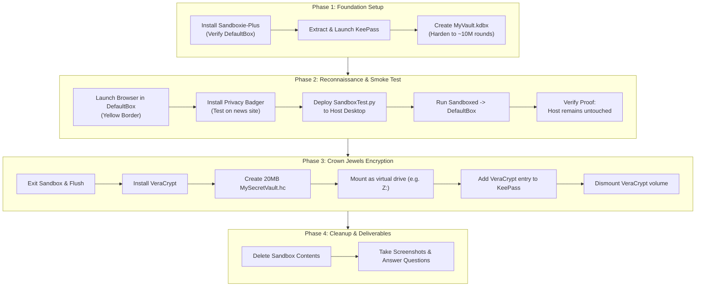

# Lab 1: Operation Digital Self-Defense — Building Your Personal Security Citadel

## 1. Overview & Context

This lab explores the core cybersecurity mindset of **Defense in Depth** through the "Citadel" analogy. Rather than relying on a single defensive layer (such as basic antivirus), you construct a multi-layered fortress around your system, privacy, and sensitive data.

### The Scenario

You are a journalist researching a sensitive topic. You need to inspect and download an application (`research_helper.exe`) from an untrusted website. To prevent potential malware from stealing research notes or compromising the host system, you deploy four layered defenses to safely isolate, test, and protect your environment.

---

## 2. What We Need to Get Started

### System & Environment

- **Host OS**: Windows 10 / 11
- **Python**: Installed virtual environment (`.venv` in the repository root) using `.\.venv\Scripts\python.exe`

### Required Tools & Downloads

| Defense Layer               | Tool               | Source / Official Link                                               | Purpose                                                   |
|:--------------------------- |:------------------ |:-------------------------------------------------------------------- |:--------------------------------------------------------- |
| **Layer 1: The Moat**       | **Sandboxie-Plus** | [Sandboxie-Plus GitHub](https://github.com/sandboxie-plus/Sandboxie) | Application process isolation & clean sandbox environment |
| **Layer 2: The Sentries**   | **Privacy Badger** | [EFF Privacy Badger](https://privacybadger.org)                      | Autonomous tracking and spyware blocker extension         |
| **Layer 3: The Gatekeeper** | **KeePass**        | [KeePass Official](https://keepass.info)                             | Encrypted offline password vault (`.kdbx`)                |
| **Layer 4: The Keep**       | **VeraCrypt**      | [VeraCrypt Official](https://www.veracrypt.fr)                       | On-the-fly encrypted disk container (`.hc`)               |

---

## 3. Learning Objectives

By the end of this lab, you will be able to:

1. **Implement Defense in Depth**: Articulate and deploy independent, complementary defensive layers for personal endpoint security.
2. **Execute Application Sandboxing**: Run untrusted binaries and browsers inside an isolated sandbox (`DefaultBox`) to block persistent system changes.
3. **Manage Cryptographic Vaults**: Generate and store unique, complex credentials using KeePass with hardened key transformation rounds.
4. **Deploy On-the-Fly Disk Encryption (OTFE)**: Create and mount encrypted volume containers using VeraCrypt (AES-256 / SHA-512/SHA-256).
5. **Enforce Online Tracking Protection**: Configure browser privacy controls to stop invisible behavioral tracking.
6. **Perform an Isolation Smoke Test**: Prove sandbox isolation by running a test script that attempts host file creation and Recycle Bin clearing.

---

## 4. Step-by-Step Completion Guide



### Phase 1: Fortifying the Foundation (Pre-Browsing Setup)

#### Step 1: Deploy the Moat (Sandboxie-Plus)

1. Download the latest installer from [Sandboxie-Plus GitHub Releases](https://github.com/sandboxie-plus/Sandboxie/releases).
2. Run the installer accepting default options (restart Windows if prompted).
3. Open Sandboxie-Plus and confirm that `DefaultBox` is present. This is your isolated execution room.

#### Step 2: Forge Strong Keys (KeePass)

1. Download the portable zip archive from [keepass.info](https://keepass.info/download.html).
2. Extract the archive into a dedicated folder (e.g., `C:\Tools\KeePass`).
3. Run `KeePass.exe`:
   - Click **File** > **New...**
   - Save the database as `MyVault.kdbx` in your `Documents` folder.
   - Choose a strong master passphrase (e.g., `Correct-Horse-Battery-Staple-42!`).
   - Harden the key derivation: go to **File** > **Database Settings** > **Security** tab > increase the **Number of key transformation rounds** to `10000000` (~10 Million) or use Argon2d. Click **OK**.

---

### Phase 2: Reconnaissance Mission & Isolation Smoke Test

#### Step 3: Conduct Safe Reconnaissance

1. Right-click your web browser shortcut (Chrome, Firefox, Edge, etc.) and select **Run Sandboxed -> DefaultBox**.
2. Notice the yellow outline/border around the window indicating it is running in an isolated container.
3. In this sandboxed browser, navigate to [privacybadger.org](https://privacybadger.org) and install the extension.
4. Browse to a major news website (e.g., CNN, Reuters, BBC). Open the Privacy Badger extension icon to inspect blocked third-party tracking cookies and domains.

#### Step 4: The Isolation "Smoke Test"

This step verifies that the sandbox confines file writes and destructive actions.

1. **Create the Script**:
   Create `SandboxTest.py` on your host Desktop with the following script:
   
   ```python
   import os
   from pathlib import Path
   import subprocess
   
   def main():
       desktop_path = Path.home() / "Desktop" / "SandboxTestFile.txt"
       try:
           with open(desktop_path, 'w') as f:
               f.write("This file was created inside the sandbox.")
           print("Test file created on Desktop.")
       except Exception as e:
           print(f"Error creating file: {e}")
       print()
   
       print("Now attempting to clear the Recycle Bin...")
       try:
           subprocess.run(
               ["powershell", "-Command", "Clear-RecycleBin -Force"],
               check=True,
               shell=True
           )
           print("Recycle Bin clearance command executed.")
       except Exception as e:
           print(f"An error occurred: {e}")
       print()
       input("Press Enter to exit...")
   
   if __name__ == "__main__":
       main()
   ```

2. **Execute Inside the Sandbox**:
   
   - Right-click `SandboxTest.py` on your host Desktop and select **Run Sandboxed -> DefaultBox**.
   - Let the script finish and press Enter.

3. **Verify the Proof**:
   
   - **Inside Sandbox**: Open a sandboxed File Explorer window. You will see `SandboxTestFile.txt` on the Desktop and the Recycle Bin empty.
   - **On Host System (Reality)**: Check your physical Desktop. `SandboxTestFile.txt` does **not** exist. Check your real host Recycle Bin—none of its items were deleted.

---

### Phase 3: Securing the Crown Jewels (Data Encryption)

#### Step 5: Build the Inner Keep (VeraCrypt)

1. Close all sandboxed windows. In the Windows system tray, right-click Sandboxie and click **Terminate All Programs**.
2. Download and install VeraCrypt from [veracrypt.fr](https://www.veracrypt.fr).
3. Open VeraCrypt and click **Create Volume**:
   - Select **Create an encrypted file container** > **Standard VeraCrypt volume**.
   - Set file location to `Documents\MySecretVault.hc`.
   - Select encryption algorithm (**AES**) and hash algorithm (**SHA-256** or **SHA-512**).
   - Set volume size to `20 MB`.
   - Set a strong password distinct from your KeePass master password.
   - Move your mouse randomly over the window to generate entropy, then click **Format**.
4. **Mount Volume**:
   - Select an available drive letter (e.g. `Z:`).
   - Click **Select File...**, choose `Documents\MySecretVault.hc`, click **Mount**, and enter your password.
   - Drive `Z:` appears in Windows Explorer. You can create files inside it with transparent encryption.
5. **Dismount**: Return to VeraCrypt and click **Dismount**.

#### Step 6: Vault Management in KeePass

1. Open KeePass on your host system.
2. Click **Add Entry**:
   - **Title**: `My Secret VeraCrypt Vault`
   - **Password**: Enter the password you used for the VeraCrypt container.
3. Save the KeePass database.

---

### Phase 4: After-Action Review & Cleanup

1. In Sandboxie-Plus, right-click `DefaultBox` and select **Delete Contents** to permanently discard all isolated files and temporary state.
2. (Optional) Remove `SandboxTest.py` from your Desktop.

---

## 5. Lab Deliverables & Discussion Questions

### Required Deliverable

- **Screenshot**: One single screenshot displaying:
  1. Your **KeePass** application window open showing the `My Secret VeraCrypt Vault` entry.
  2. The **VeraCrypt** main interface showing your `MySecretVault.hc` mounted as a virtual drive letter (e.g. `Z:`).

### Discussion Questions & Answers Reference

1. **Isolation Report**:
   - *Question*: Describe the results of the `SandboxTest.py` script. What did you observe on the host system versus inside the sandbox?
   - *Key takeaway*: Sandboxing redirects file writes and OS modifications to an isolated virtual storage layer. The host OS remains pristine.
2. **Critical Thinking**:
   - *Question*: If `research_helper.exe` had been real malware, what specific damage could it have done if run outside the sandbox that was prevented by running it inside?
   - *Key takeaway*: Keyloggers, ransomware, persistence mechanisms (registry run keys, services), and credential dumping cannot persist or reach host files.
3. **Strategy**:
   - *Question*: Explain how using KeePass protects you from a credential stuffing attack compared to password reuse.
   - *Key takeaway*: Credential stuffing relies on leaked username/password pairs from breached sites. Unique high-entropy passwords mean a breach on one site grants zero access to any other account.
4. **Physical Security**:
   - *Question*: If your laptop were stolen, what two things would prevent the thief from accessing the files inside your VeraCrypt volume?
   - *Key takeaway*: (1) The volume file is strongly encrypted at rest (AES-256), requiring the secret passphrase; (2) The volume must be mounted into RAM to be readable; when dismounted or powered down, the plaintext keys are gone.
5. **The Human Element**:
   - *Question*: Which layer of defense (Moat, Sentries, Gatekeeper, Keep) is most often overlooked by average users, and why?
   - *Key takeaway*: The Gatekeeper (password management) or Keep (at-rest encryption). Users often reuse simple passwords or leave sensitive files unencrypted on disks due to convenience bias.
