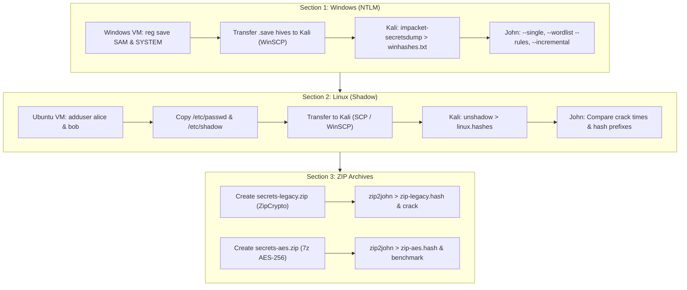

# Lab 2: Password Cracking — Windows, Linux & ZIP

## 1. Overview & Context
- **Theme**: Red vs Blue — *Can you break it, can you fix it?*
- **Estimated Time**: 2–3 Hours
- **Difficulty**: Intermediate
- **Ethical Boundary**: All testing must strictly be performed inside your designated lab virtual machines and isolated files.

This lab covers both offensive password recovery/cracking techniques (Red Team) and defensive credential hardening (Blue Team). You will extract password hashes from Windows (NTLM) and Linux (shadow), examine the impact of salts, rounds, and modern algorithms, and analyze the cryptographic resilience of ZipCrypto versus AES-256 encrypted archives.

---

## 2. What We Need to Get Started

### Virtual Machines & Environment
1. **Kali Linux VM**: Attacker machine with John the Ripper suite installed.
2. **Windows 10 VM**: Target machine with local Administrator privileges.
3. **Ubuntu Linux VM (22.04 LTS)**: Target machine with `sudo` privileges.
4. **Host Network**: Host-only or NAT Network enabling connectivity between Kali, Windows, and Ubuntu.
5. **Snapshots**: Take a clean snapshot of all VMs before starting.

### Tools & Wordlists Checklist
- **John the Ripper** (`john`, `zip2john`, `unshadow`)
- **Impacket** (`impacket-secretsdump`)
- **Wordlist**: `rockyou.txt` (Decompressed: `gunzip /usr/share/wordlists/rockyou.txt.gz`)
- **File Transfer**: WinSCP (GUI) or `scp`
- **Archive Utilities**: `zip` and `p7zip-full` (`7z`)

---

## 3. Learning Objectives
1. **Differentiate Hashing Architectures**: Understand how Windows NTLM functions without salts vs. how modern Linux hashing employs per-user salts and computational work factors (rounds).
2. **Hash Extraction**: Safely acquire offline registry hives (`SAM` & `SYSTEM`) on Windows and shadow files (`/etc/passwd` & `/etc/shadow`) on Linux.
3. **Tool Mastery**: Utilize Impacket (`secretsdump`), `unshadow`, and `zip2john` to format hashes for John the Ripper.
4. **Attack Modes**: Compare the speed and efficacy of `--single` (seed-based), `--wordlist --rules` (mangled dictionary attack), and `--incremental` (brute force).
5. **Archive Cryptography**: Differentiate between the weak stream-cipher implementation in PKZIP 2.0 (ZipCrypto) and modern authenticated AES-256 encryption.
6. **Blue Team Hardening**: Formulate enterprise mitigations including passphrases, MFA, disabling legacy protocols, and migrating to memory-hard hashing functions (yescrypt / bcrypt).

---

## 4. Step-by-Step Completion Guide



---

### Section 1: Cracking Windows Passwords (NTLM)

#### Step 1: Extract Windows Registry Hives (Offline Method)
On the **Windows 10 VM**, launch an elevated Command Prompt (`cmd` run as Administrator):
```cmd
reg save HKLM\SAM C:\Users\Public\SAM.save
reg save HKLM\SYSTEM C:\Users\Public\SYSTEM.save
```
- `HKLM\SAM`: Stores local account credentials and encrypted NTLM hashes.
- `HKLM\SYSTEM`: Contains the Boot Key / SysKey necessary to decrypt the SAM database.

#### Step 2: Transfer Hives to Kali Linux
1. Launch **WinSCP** on the Windows VM.
2. Connect to Kali via SFTP:
   - **Host**: Kali VM IP (find with `ip a` on Kali)
   - **Username / Password**: Your Kali credentials
3. Transfer `SAM.save` and `SYSTEM.save` from `C:\Users\Public\` to `/home/kali/`.

#### Step 3: Extract NTLM Hashes with Impacket
On **Kali Linux**:
```bash
# Install Impacket if not present
sudo apt update && sudo apt install -y python3-impacket

# Extract hashes from the hives
impacket-secretsdump -sam SAM.save -system SYSTEM.save LOCAL > winhashes.txt

# Inspect extracted hashes
cat winhashes.txt
```

#### Step 4: Execute Cracking with John the Ripper
Prepare the wordlist:
```bash
sudo gunzip -k /usr/share/wordlists/rockyou.txt.gz
```

Test the three attack modes:
1. **Single Mode** (Fast wins using account metadata and usernames as seeds):
   ```bash
   john --single --format=NT winhashes.txt
   ```
2. **Wordlist + Rules** (Primary attack using RockYou with permutation rules):
   ```bash
   john --format=NT --wordlist=/usr/share/wordlists/rockyou.txt --rules winhashes.txt
   ```
3. **Incremental Mode** (Exhaustive brute force):
   ```bash
   john --format=NT --incremental winhashes.txt
   ```
4. **Display Cracked Credentials**:
   ```bash
   john --show --format=NT winhashes.txt
   ```

---

### Section 2: Cracking Linux Passwords (Shadow-Based)

#### Step 1: Create Test Accounts
On the **Ubuntu VM**:
```bash
# Weak password user
sudo adduser alice   # Set password to: P@ssw0rd123

# Strong passphrase user
sudo adduser bob     # Set password to: correct horse battery staple purple
```

#### Step 2: Copy Database Files
```bash
sudo cp /etc/passwd ~/passwd.copy
sudo cp /etc/shadow ~/shadow.copy
sudo chmod 644 ~/passwd.copy ~/shadow.copy
```

#### Step 3: Transfer to Kali
From **Kali Linux** via `scp`:
```bash
scp <ubuntu_user>@<UBUNTU_IP>:~/passwd.copy ~/ubuntu-passwd.copy
scp <ubuntu_user>@<UBUNTU_IP>:~/shadow.copy ~/ubuntu-shadow.copy
```

#### Step 4: Combine Files with `unshadow`
On **Kali Linux**:
```bash
unshadow ~/ubuntu-passwd.copy ~/ubuntu-shadow.copy > linux.hashes
```

*Hash Type Reference:*
- `$1$`: MD5-crypt (Legacy, weak)
- `$6$`: SHA-512-crypt (Modern standard, variable rounds)
- `$2y$`: bcrypt (Memory/compute intensive)
- `$y$`: yescrypt (Modern default in Ubuntu 22.04 / Debian, resistant to GPU/ASIC cracking)

#### Step 5: Crack Linux Hashes
```bash
# 1. Single mode
john --single linux.hashes

# 2. Wordlist + Rules
john --wordlist=/usr/share/wordlists/rockyou.txt --rules linux.hashes

# 3. Incremental
john --incremental linux.hashes

# 4. View results
john --show linux.hashes
```

---

### Section 3: Cracking ZIP Files (ZipCrypto vs. AES-256)

#### Part A: Legacy ZipCrypto
1. Create a test archive on **Kali**:
   ```bash
   echo "Top secret lab note" > secret.txt
   zip -e secrets-legacy.zip secret.txt
   # Enter a simple password (e.g. dragon or 123456)
   ```
2. Extract hash and crack:
   ```bash
   zip2john secrets-legacy.zip > zip-legacy.hash
   john --wordlist=/usr/share/wordlists/rockyou.txt --rules zip-legacy.hash
   john --show zip-legacy.hash
   ```

#### Part B: Modern AES-256 Encryption
1. Create an AES-256 archive using `7z`:
   ```bash
   7z a -p -mem=AES256 secrets-aes.zip secret.txt
   # Enter a strong multi-word passphrase
   ```
2. Extract hash and attempt cracking:
   ```bash
   zip2john secrets-aes.zip > zip-aes.hash
   john --wordlist=/usr/share/wordlists/rockyou.txt --rules zip-aes.hash
   ```
3. Allow to run for several minutes. Observe that the strong cipher combined with high entropy renders the dictionary attack unsuccessful.

---

## 5. Lab Questions & Answers Reference Guide

### Section 1 Questions (Windows / NTLM)
1. **Why does the lack of a salt make NTLM susceptible to massive precomputed attacks?**
   - *Answer*: Without a unique per-user salt, identical passwords always yield identical NTLM hashes across all systems. Attackers can precalculate massive lookup tables (Rainbow Tables) to reverse hashes in seconds.
2. **If you increase password length to 16+ chars (passphrases), what happens to attack feasibility?**
   - *Answer*: The keyspace expands exponentially ($95^{16+}$ for printable ASCII). Offline brute-force and dictionary attacks become mathematically infeasible within realistic computational budgets.
3. **Name two Windows defensive controls to reduce NTLM risk in enterprises.**
   - *Answer*: (1) Enforce Kerberos-only authentication and disable/restrict NTLM via Group Policy (`Network security: Restrict NTLM`); (2) Implement Protected Users security group and Credential Guard to prevent LSA hash caching.
4. **What is Pass-the-Hash, and how is it different from cracking?**
   - *Answer*: Pass-the-Hash (PtH) is an authentication reuse attack where the attacker presents the captured NTLM hash directly to authenticate across a network without ever cracking or knowing the plaintext password.

### Section 2 Questions (Linux / Shadow)
1. **What is a salt and how does it defeat precomputed rainbow tables?**
   - *Answer*: A salt is a cryptographically random string appended to the password prior to hashing. It ensures two users with identical passwords have completely different hashes, forcing an attacker to generate precomputed tables individually for each unique salt.
2. **What do rounds (e.g., in SHA-512-crypt) do to an attacker’s cost per guess?**
   - *Answer*: Rounds iterate the hashing loop thousands of times (default 5,000 in SHA-512). This linearly multiplies the compute time per guess, drastically reducing the cracking throughput (guesses per second).
3. **Why is bcrypt/yescrypt generally more resistant than MD5/SHA-512-crypt at the same hardware budget?**
   - *Answer*: `bcrypt` and `yescrypt` are memory-hard and cache-resistant algorithms. They require substantial RAM per evaluation, severely penalizing high-throughput parallel cracking architectures like GPUs and ASICs.

### Section 3 Questions (ZIP Archives)
1. **Why is ZipCrypto usually crackable but AES-encrypted ZIPs aren't (given strong passwords)?**
   - *Answer*: ZipCrypto uses a legacy, flawed 96-bit internal state stream cipher vulnerable to known-plaintext attacks and high-speed offline cracking. AES-256 uses robust block cipher cryptography with PBKDF2/HMAC key derivation; with sufficient passphrase entropy, offline recovery is computationally infeasible.
2. **What strategies would you use to guess a human-chosen but memorable passphrase?**
   - *Answer*: Targeted wordlists (crunch, cewl), phrase-based mask attacks, combinator attacks (joining 3-4 common words), and custom transformation rules mimicking phonetic and l33t substitutions.
