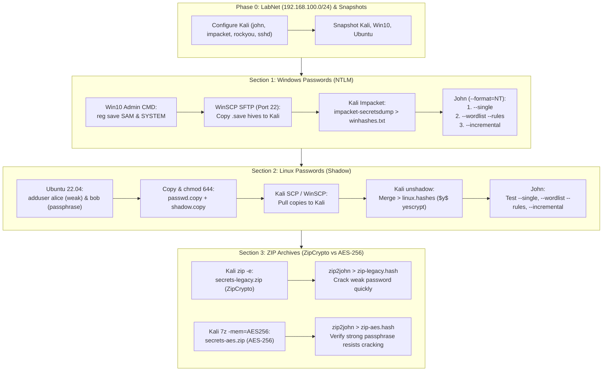

# Lab 2: Password Cracking — Windows, Linux & ZIP

## 1. Overview & Context

- **Theme**: Red vs Blue — *Can you break it, can you fix it?*
- **Estimated Time**: 2–3 Hours (plus initial VM staging)
- **Difficulty**: Intermediate
- **Source Handout**: [`Lab_2.docx.pdf`](file:///d:/Dev/Projects/Computer-Security-Labs/Labs/Lab2/Lab_2.docx.pdf)
- **Deliverables Folder**: [`Labs/Lab2/Deliverables/`](file:///d:/Dev/Projects/Computer-Security-Labs/Labs/Lab2/Deliverables/)

> [!CAUTION]
> **Ethical Boundary**: Do not attempt any of these techniques on real systems you do not own or lack explicit permission to test. All hash extraction and password cracking must be performed strictly inside your isolated lab virtual machines and test files.

This lab explores both **Red Team** offline password recovery techniques and **Blue Team** credential hardening. You will safely extract local account hashes from Windows (`SAM` + `SYSTEM` registry hives) and Linux (`/etc/passwd` + `/etc/shadow`), compare John the Ripper's core attack modes (`--single`, `--wordlist --rules`, and `--incremental`), evaluate how salts, iteration rounds, and memory-hard functions (`yescrypt` / `bcrypt`) impact cracking speed, and test legacy `ZipCrypto` archives against `AES-256` encrypted archives.

---

## 2. Core Cryptographic & OS Definitions

| Term | Location / Prefix | Role in Authentication & Cracking |
| :--- | :--- | :--- |
| **NTLM (NT LAN Manager)** | Windows SAM (`nthash`) | Fast MD4-based password hash (`MD4(UTF-16LE(password))`). **Unsalted**, making identical passwords produce identical hashes everywhere—vulnerable to rainbow tables, high-speed GPU cracking, and **Pass-the-Hash (PtH)** reuse. |
| **SAM Hive** | `C:\Windows\System32\config\SAM` | Windows Security Account Manager registry hive storing local user accounts and encrypted NTLM hashes. Locked by the OS kernel while Windows is running. |
| **SYSTEM Hive** | `C:\Windows\System32\config\SYSTEM` | Windows OS configuration hive containing the **Boot Key (`SysKey`)** required to decrypt the password hashes inside `SAM`. Neither file alone is sufficient. |
| **`/etc/passwd` & `/etc/shadow`** | Ubuntu / Kali Linux | `/etc/passwd` stores world-readable account metadata (UID, GID, home, shell); `/etc/shadow` stores root-only salted password hashes (`$<id>$<params>$<salt>$<hash>`). |
| **Hash Prefixes** | `$1$`, `$6$`, `$2y$`, `$y$` | `$1$` = MD5-crypt (legacy/weak); `$6$` = SHA-512-crypt (iterated rounds, default 5,000); `$2y$` = bcrypt; `$y$` = **yescrypt** (modern default on Ubuntu 22.04 & Kali, memory-hard against GPUs/ASICs). |

---

## 3. Environment Setup & Tool Configuration

### 3.1 Host Storage & Memory Rules (Important)

- **Store all VMs and ISOs on `D:\` (not `C:\`)**: Create `D:\VMs\VirtualBox` and `D:\VMs\Images`. Before importing any VM in VirtualBox, open **File → Preferences (`Ctrl+G`) → General** and set **Default Machine Folder** to `D:\VMs\VirtualBox`.
- **Free Host RAM Before Booting VMs**: Quit **Docker Desktop** from the Windows system tray and run `wsl --shutdown` in PowerShell before starting VirtualBox.
- **Run at Most 2 VMs Simultaneously**:
  - **Section 1**: Boot **Kali + Windows 10** to export and transfer `SAM.save` & `SYSTEM.save`, then **shut down Windows 10** before cracking on Kali.
  - **Section 2**: Boot **Kali + Ubuntu 22.04** to copy and transfer `passwd.copy` & `shadow.copy`, then **shut down Ubuntu** before cracking on Kali.
  - **Section 3**: Only **Kali Linux** needs to run.

### 3.2 Hypervisor & Virtual Network Setup

1. **Install VirtualBox & 7-Zip on Windows Host** (if not yet installed):
   ```powershell
   winget install -e --id Oracle.VirtualBox
   winget install -e --id 7zip.7zip
   ```
2. **Create an Isolated NAT Network (`LabNet`)**:
   - In VirtualBox, open **File → Tools → Network Manager → NAT Networks** → click **Create**.
   - **Name**: `LabNet` | **IPv4 Prefix**: `192.168.100.0/24` | Check **Enable DHCP** → click **Apply**.
   - For **all three VMs** (Kali, Windows 10, Ubuntu 22.04), go to **Settings → Network → Adapter 1** and select **Attached to: NAT Network** (`LabNet`).
   - *Why `LabNet`?* Every VM gets internet access (to `apt install` packages) **and** direct VM-to-VM SFTP/SCP connectivity on the `192.168.100.x` subnet using a single adapter.

### 3.3 Virtual Machine Preparation

| VM | Recommended Specs | Setup & Required Configuration |
| :--- | :--- | :--- |
| **Kali Linux VM** *(Attacker)* | 2–3 GB RAM, 2 vCPUs | Download pre-built VirtualBox image from [kali.org](https://www.kali.org/get-kali/#kali-virtual-machines), extract `.7z` into `D:\VMs\`, double-click `.vbox` to register. Default login: `kali` / `kali`. |
| **Windows 10 VM** *(Target 1)* | 2–3 GB RAM, 2 vCPUs | Install from Windows 10 ISO onto `D:\VMs\VirtualBox`. During OOBE setup, select **"I don't have internet" → "Continue with limited setup"** so a **local Administrator** account is created (not a Microsoft online account). |
| **Ubuntu 22.04 LTS VM** *(Target 2)* | 1.5–2 GB RAM, 1–2 vCPUs | Install Ubuntu 22.04 LTS Server or Desktop ISO onto `D:\VMs\VirtualBox` with a `sudo` user. |

### 3.4 Configure & Verify All Tools Inside VMs

#### A. On Kali Linux VM
```bash
# 1. Update package index and install all required Lab 2 packages
sudo apt update
sudo apt install -y john python3-impacket wordlists zip p7zip-full openssh-server

# 2. Decompress rockyou.txt wordlist (keeps .gz backup intact)
sudo gzip -dk /usr/share/wordlists/rockyou.txt.gz
ls -lh /usr/share/wordlists/rockyou.txt

# 3. Enable & start SSH daemon so Windows WinSCP can connect to Kali over SFTP (port 22)
sudo systemctl enable --now ssh
sudo systemctl is-active ssh

# 4. Verify all required binaries and note Kali's IP address
which john unshadow zip2john impacket-secretsdump zip 7z
ip -br -4 addr
```

#### B. On Windows 10 Target VM
1. **Install WinSCP** (GUI SFTP client required by Section 1B): Download from [winscp.net](https://winscp.net/) or run in Windows 10 PowerShell:
   ```powershell
   winget install -e --id WinSCP.WinSCP
   ```
2. **Seed Local Test Users** (run `cmd` as **Administrator**):
   ```cmd
   net user cyberx 123456 /add
   net user hacker Password /add
   net user jsmith jsmith1 /add
   ```
   *(Creates weak dictionary accounts matching the handout output plus a username-based password so `--single` mode demonstrates a hit.)*

#### C. On Ubuntu 22.04 LTS VM
```bash
# Install and enable SSH server so Kali can pull files via SCP/SFTP
sudo apt update && sudo apt install -y openssh-server
sudo systemctl enable --now ssh
ip -br -4 addr
```

#### D. Take Clean Pre-Lab Snapshots
Before starting Section 1, take a clean snapshot (**Machine → Take Snapshot…**, named `Pre-Lab2-Clean`) on **Kali**, **Windows 10**, and **Ubuntu 22.04**.

---

## 4. Architecture & Execution Workflow



---

## 5. Step-by-Step Completion Guide

> [!WARNING]
> **Handout Errata (Commands Fixed Below)**:
> 1. Page 5 of `Lab_2.docx.pdf` has a missing space/letter in `--rulewinhashes.txt` — the valid flag is `--rules winhashes.txt`.
> 2. Page 5 lists `gunzip rockyou.txt.gz - rockyou.txt` — valid syntax is `sudo gzip -dk /usr/share/wordlists/rockyou.txt.gz`.
> 3. **John Potfile Tip**: John caches cracked hashes in `~/.john/john.pot`. Once a hash is cracked in `--single`, subsequent modes skip it and print `No password hashes left to crack`. Below we pass mode-specific `--pot=` files when comparing modes so you can benchmark and screenshot all three modes cleanly.

Create a clean working directory on Kali before starting:
```bash
mkdir -p ~/lab2 && cd ~/lab2
```

---

### Section 1: Cracking Windows Passwords (NTLM)

#### Step 1A: Extract Registry Hives Safely (Offline Method)
On the **Windows 10 VM**, open **Command Prompt as Administrator** (`Win` → type `cmd` → **Run as administrator**):
```cmd
reg save HKLM\SAM C:\Users\Public\SAM.save /y
reg save HKLM\SYSTEM C:\Users\Public\SYSTEM.save /y
dir C:\Users\Public\*.save
```
- `SAM.save` (~48 KB) holds encrypted local NTLM hashes; `SYSTEM.save` (~10–16 MB) holds the Boot Key (`SysKey`) needed to decrypt them. *(If `SYSTEM.save` is also 48 KB, `HKLM\SAM` was accidentally exported twice, which causes Impacket to fail with `[-] 'NoneType' object is not subscriptable`.)*

#### Step 1B: Transfer `.save` Files to Kali via WinSCP
1. On **Kali**, check your IP address (`ip -br -4 addr`, e.g., `192.168.100.10`).
2. On **Windows 10**, open **WinSCP** and create a **New Session**:
   - **File protocol**: `SFTP` | **Port**: `22`
   - **Host name**: `<Kali-IP>`
   - **User name**: `kali` | **Password**: `<your-kali-password>`
3. Click **Login**, accept the host key, navigate the left pane to `C:\Users\Public\` and the right pane to `/home/kali/lab2/`, and drag `SAM.save` and `SYSTEM.save` over.
4. Confirm on Kali (`ls -lh ~/lab2/*.save`), then **shut down the Windows 10 VM** to free host RAM.
   - *(Screenshot Checkpoint 1: WinSCP transfer & files present in Kali.)*

#### Step 1C: Convert Hives to NTLM Hashes (`impacket-secretsdump`)
On **Kali** (`~/lab2`):
```bash
impacket-secretsdump -sam SAM.save -system SYSTEM.save LOCAL > winhashes.txt
cat winhashes.txt
```
- **Understanding the Output** (`user:RID:LM_HASH:NT_HASH:::`):
  - `aad3b435b51404eeaad3b435b51404ee`: Empty **LM** hash (modern Windows disables LM).
  - `31d6cfe0d16ae931b73c59d7e0c089c0`: Empty **NTLM** hash (accounts with blank passwords).
  - `cyberx`, `hacker`, `jsmith`: Active local NTLM hashes to crack!
  - *(Screenshot Checkpoint 2: `cat winhashes.txt` showing bootKey and dumped NTLM hashes.)*

#### Step 1D: Crack NTLM Hashes with John (3 Attack Modes)
```bash
# 1. Single Mode (uses usernames & GECOS metadata as seeds — cracks jsmith1 instantly)
john --single --format=NT --pot=nt_single.pot winhashes.txt

# 2. Wordlist + Rules Mode (dictionary + mangling rules — cracks cyberx & hacker)
john --format=NT --wordlist=/usr/share/wordlists/rockyou.txt --rules --pot=nt_wordlist.pot winhashes.txt

# 3. Incremental Mode (character-by-character brute force; press 'q' or Ctrl+C after observing/cracking short passwords)
john --format=NT --incremental --pot=nt_inc.pot winhashes.txt

# 4. Populate default potfile and display all cracked Windows credentials
john --format=NT --wordlist=/usr/share/wordlists/rockyou.txt --rules winhashes.txt
john --show --format=NT winhashes.txt
```
- *(Screenshot Checkpoint 3: John cracking NTLM hashes and `john --show --format=NT winhashes.txt` output.)*

---

### Section 2: Cracking Linux Passwords (`shadow`-Based)

#### Step 2.1: Create Two Test Users on Ubuntu 22.04
Boot the **Ubuntu 22.04 LTS VM** and create one weak account and one strong passphrase account:
```bash
# User 1 (Easy password near top of rockyou.txt so yescrypt cracks quickly):
sudo adduser alice
# Enter password: password123  (or P@ssw0rd123 — note yescrypt speed tip below!)

# User 2 (Strong multi-word passphrase, 5+ random words):
sudo adduser bob
# Enter password: velvet-orbit-lantern-glacier-sparrow
```
> [!TIP]
> **Why `password123` vs `P@ssw0rd123` Matters on Ubuntu 22.04 (`yescrypt`)**: Ubuntu 22.04 hashes passwords with `$y$` (`yescrypt`), which intentionally runs at only ~50–250 guesses/sec on a VM CPU (compared to millions/sec for NTLM). Top dictionary words like `password123` crack in seconds, proving dictionary vulnerability, whereas words requiring multi-pass `--rules` over 14.3M entries can take hours under `yescrypt`! If you use `P@ssw0rd123`, you can also verify it swiftly with a targeted list or check live progress by pressing `Space` while John runs.

#### Step 2.2: Safely Copy Account Databases on Ubuntu
```bash
sudo cp /etc/passwd ~/passwd.copy
sudo cp /etc/shadow ~/shadow.copy
sudo chmod 644 ~/passwd.copy ~/shadow.copy
ip -br -4 addr
```

#### Step 2.3: Transfer Copies to Kali
On **Kali** (`~/lab2`), replace `<ubuntu_user>` and `<Ubuntu-IP>`:
```bash
scp <ubuntu_user>@<Ubuntu-IP>:~/passwd.copy ~/lab2/ubuntu-passwd.copy
scp <ubuntu_user>@<Ubuntu-IP>:~/shadow.copy ~/lab2/ubuntu-shadow.copy
```
Once transferred, you can **shut down the Ubuntu VM** (after optionally deleting `~/passwd.copy ~/shadow.copy` on Ubuntu) so Kali gets maximum CPU resources.

#### Step 2.4: Combine with `unshadow` & Inspect Hash Identifiers
On **Kali** (`~/lab2`):
```bash
unshadow ubuntu-passwd.copy ubuntu-shadow.copy > linux.hashes
grep -E "^(alice|bob):" linux.hashes
```
- Inspect the hash prefix right after `alice:` — on Ubuntu 22.04 you will see `$y$j9T$...` (**yescrypt**), with a unique random per-user salt between the `$` delimiters! Notice that even if `alice` and `bob` had the exact same password, their hashes would look completely different because of unique salts.

#### Step 2.5: Crack with John & Compare Difficulty
```bash
# 1. Single Mode
john --single linux.hashes

# 2. Wordlist + Rules Mode (alice cracks; press Space to inspect c/s speed, then 'q' after a couple minutes once alice is cracked and bob resists)
john --wordlist=/usr/share/wordlists/rockyou.txt --rules linux.hashes

# 3. Incremental Mode (run for 1-2 minutes, press Space to record slow yescrypt c/s vs NTLM, then press 'q' to stop)
john --incremental linux.hashes

# 4. Show cracked Linux credentials
john --show linux.hashes
```
- *(Screenshot Checkpoint 4: `unshadow` output showing `$y$` hashes + `john --show linux.hashes` showing `alice` cracked while `bob` remains uncracked.)*

---

### Section 3: Cracking ZIP Files (`ZipCrypto` vs. `AES-256`)

#### Part 3A: Create & Crack a Legacy `ZipCrypto` Archive
On **Kali** (`~/lab2`):
```bash
# 1. Create sample sensitive file and encrypt with legacy PKZIP 2.0 (ZipCrypto)
echo "Top secret lab note - confidential project credentials inside" > secret.txt
zip -e secrets-legacy.zip secret.txt
# When prompted, enter a weak demo password (e.g., dragon or monkey123)

# 2. Extract PKZIP hash metadata for John
zip2john secrets-legacy.zip > zip-legacy.hash
cat zip-legacy.hash

# 3. Crack with RockYou + Rules and display result
john --wordlist=/usr/share/wordlists/rockyou.txt --rules zip-legacy.hash
john --show zip-legacy.hash
```
- *(Screenshot Checkpoint 5: `zip2john` `$pkzip$` extraction and instant password recovery via `john --show zip-legacy.hash`.)*

#### Part 3B: Create & Test an `AES-256` Encrypted ZIP Archive
On **Kali** (`~/lab2`):
```bash
# 1. Create a WinZip AES-256 encrypted .zip archive using 7z
7z a -tzip -p -mem=AES256 secrets-aes.zip secret.txt
# When prompted, enter a strong multi-word passphrase (e.g., crimson-falcon-harbor-quartz-92)

# 2. Extract AES ZIP hash ($zip2$ PBKDF2-HMAC-SHA1)
zip2john secrets-aes.zip > zip-aes.hash
cat zip-aes.hash

# 3. Attempt dictionary + rules attack for 2-3 minutes
john --wordlist=/usr/share/wordlists/rockyou.txt --rules zip-aes.hash
# Press Space to observe speed (PBKDF2 slows guesses dramatically), then press 'q' after a few minutes
john --show zip-aes.hash
```
- Observe `0 password hashes cracked, 1 left` — proving that modern `AES-256` + PBKDF2 key derivation paired with a high-entropy passphrase defeats offline cracking.
- *(Screenshot Checkpoint 6: `7z -mem=AES256` creation + John failing to crack `zip-aes.hash`.)*

---

## 6. Required Deliverables & Reference Answers

Store your screenshots and completed notes inside [`Labs/Lab2/Deliverables/`](file:///d:/Dev/Projects/Computer-Security-Labs/Labs/Lab2/Deliverables/) using [`lab2_notes_template.md`](file:///d:/Dev/Projects/Computer-Security-Labs/Labs/Lab2/Deliverables/lab2_notes_template.md).

### Section 1 Questions (Windows / NTLM)
1. **Why does the lack of a salt make NTLM susceptible to massive precomputed attacks?**
   - **Answer**: Because NTLM hashes the UTF-16LE password directly with MD4 without adding any random per-user data (salt), the same password always produces the exact same 128-bit hash on every Windows machine worldwide. Attackers can compute massive lookup tables or **Rainbow Tables** once ahead of time and reverse millions of NTLM hashes simultaneously in O(1) lookup time.
2. **If you increase password length to 16+ chars (passphrases), what happens to attack feasibility?**
   - **Answer**: Every additional character multiplies the search space exponentially ($N^L$, e.g., $95^{16} \approx 4.4 \times 10^{31}$ combinations for full printable ASCII, or high word-level entropy for multi-word passphrases). Even at billions of NTLM hashes per second on GPU clusters, brute-forcing a genuinely random 16+ character passphrase takes millennia, rendering offline brute-force infeasible.
3. **Name two Windows defensive controls to reduce NTLM risk in enterprises.**
   - **Answer**:
     1. **Restrict / Audit / Disable NTLM** via Group Policy (`Network security: Restrict NTLM: NTLM authentication in this domain`) and enforce **Kerberos** authentication.
     2. Enable **Windows Defender Credential Guard** (virtualization-based LSA isolation) and add privileged accounts to the **Protected Users** security group (which blocks NTLM credential caching in LSASS memory), paired with **MFA** and `LAPS` (Local Administrator Password Solution) so local admin hashes are unique per workstation.
4. **What is Pass-the-Hash, and how is it different from cracking?**
   - **Answer**: **Cracking** is an offline computational process that recovers the human-readable plaintext password from a hash. **Pass-the-Hash (PtH)** bypasses cracking completely: because NTLM challenge-response authentication uses the NTLM hash itself as the shared secret key, an attacker who steals an NTLM hash can inject/present that raw hash directly to authenticate to SMB, WMI, or WinRM services without ever knowing the plaintext password.

### Section 2 Questions (Linux / Shadow)
1. **What is a salt and how does it defeat precomputed rainbow tables?**
   - **Answer**: A **salt** is a unique, cryptographically random string generated per user and stored alongside the hash (e.g., `$y$j9T$<salt>$<hash>`), concatenated with the password before hashing. It ensures two users with identical passwords yield completely different hashes and forces an attacker to recompute every dictionary word from scratch for each individual user's salt, rendering precomputed rainbow tables useless.
2. **What do rounds (e.g., in SHA-512-crypt) do to an attacker's cost per guess?**
   - **Answer**: **Rounds** (work factor / key stretching, default 5,000 iterations in `$6$` SHA-512-crypt) force the CPU/GPU to iteratively re-hash the intermediate digest thousands of times for a single password check. A legitimate login adds only milliseconds once, whereas an offline attacker testing billions of guesses suffers a linear $5,000\times$ (or higher) reduction in guesses per second.
3. **Why is `bcrypt`/`yescrypt` generally more resistant than `MD5`/`SHA-512-crypt` at the same hardware budget?**
   - **Answer**: `MD5-crypt` and `SHA-512-crypt` are purely **compute-bound** (ALU/register operations) requiring tiny amounts of memory, allowing attackers to run tens of thousands of parallel shader cores on GPUs/FPGAs/ASICs. `bcrypt` (requiring 4 KB fast SRAM state via Eksblowfish) and especially **`yescrypt`** (a **memory-hard** KDF tunable in RAM bandwidth and footprint) bottleneck GPU VRAM latency and die area per core, drastically narrowing the attacker's hardware parallelism advantage.

### Section 3 Mini-Questions (ZIP Archives) & Blue Team Debrief
1. **Why is `ZipCrypto` usually crackable but `AES`-encrypted ZIPs aren't (given strong passwords)?**
   - **Answer**: `ZipCrypto` (PKZIP 2.0) uses a flawed, legacy 96-bit stream cipher with fast key initialization (no slow KDF), making it vulnerable to both ultra-fast dictionary/brute-force cracking (millions of guesses/sec) and Biham–Kocher known-plaintext attacks. WinZip/7-Zip `AES-256` (`-mem=AES256`) derives keys using **PBKDF2-HMAC-SHA1** (1,000 iterations + salt) and encrypts data with a cryptographically sound 256-bit block cipher; when paired with a high-entropy passphrase, offline recovery becomes computationally infeasible.
2. **What strategies would you use to guess a human-chosen but *memorable* passphrase?**
   - **Answer**: Attackers target human predictability using **combinator / passphrase wordlists** (joining 3–5 common English words, song lyrics, idioms, or OSINT terms scraped with `CeWL`), **rule-based mutations** (capitalizing first letters, common separators like `-`, `_`, `.`, appending years/symbols like `2026!`, and `l33t` substitutions), and **hybrid mask attacks** targeting grammatical templates (e.g., `Adjective-Noun-Verb-Number`).
3. **Blue Team ZIP Hardening Summary**:
   - Always select **AES-256** (`7z a -tzip -p -mem=AES256` or `.7z` with header encryption `-mhe=on`), never legacy `ZipCrypto` (default Windows "Send to Compressed Folder" has no strong native encryption, and Linux `zip -e` uses weak `ZipCrypto`).
   - Use genuinely random **4–6+ word Diceware passphrases** generated by a password manager (like KeePass from Lab 1).
   - Never reuse passwords across archives, and rotate keys when sharing sensitive archives.
