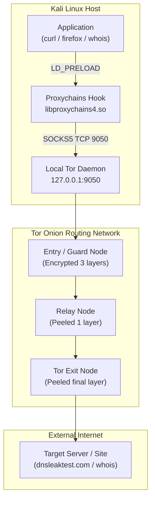

# Lab 4: Using Proxychains for Anonymous Hacking

## 1. Overview & Context

- **Theme**: Anonymity, Traffic Redirection & Network Privacy
- **Target OS**: Kali Linux (VirtualBox VM or VMware)
- **Primary Tools**: Proxychains (`proxychains4`), Tor Service (`tor`), DNS Leak Testing utilities

Proxychains is an open-source tool that intercepts TCP traffic from any command-line program and redirects it through user-defined proxy servers (such as SOCKS4, SOCKS5, HTTP, and the Tor onion routing network). It is widely used by penetration testers and red teamers to obfuscate source IP addresses, bypass firewall egress rules, and evade Intrusion Detection/Prevention Systems (IDS/IPS).

---

## 2. What We Need to Get Started

### Virtual Machines & Environment

1. **Kali Linux VM**: Attacker virtual machine inside VirtualBox or VMware.
2. **Network Adapter**: NAT or Bridged Adapter with active internet connectivity.
3. **Guest Additions**: VirtualBox Guest Additions installed for clipboard sharing and display resolution.
4. **VM Snapshot**: Take a snapshot of the Kali VM before making system configuration changes.

### Required Software & Packages

| Component | Package / Tool Name | Purpose | Installation Command |
| :--- | :--- | :--- | :--- |
| **Proxy Redirection** | `proxychains4` | Wraps dynamically linked binaries to force traffic through proxy chains | `sudo apt install proxychains4` |
| **Anonymity Network** | `tor` | Local SOCKS proxy daemon connecting to the distributed Tor onion network | `sudo apt install tor` |
| **Browsers** | `firefox-esr`, `lynx`, `w3m` | Web browsers used to verify IP spoofing and browser fingerprinting | `sudo apt install lynx w3m` |
| **Network Query Tools** | `whois`, `curl`, `dnsutils` | Command-line diagnostic and OSINT reconnaissance utilities | `sudo apt install whois curl dnsutils` |

---

## 3. Learning Objectives

By the end of this lab, you will be able to:

1. **Understand Proxy Chaining Mechanics**: Explain how TCP network sockets are hooked using dynamic library preloading (`LD_PRELOAD`) to route traffic through intermediary hops.
2. **Configure Proxychains**: Correctly edit `/etc/proxychains4.conf` to switch from `strict_chain` to `dynamic_chain`, configure SOCKS5 local routing (`127.0.0.1:9050`), and enable `proxy_dns`.
3. **Deploy & Manage Tor**: Start, stop, restart, and inspect the local `tor.service` daemon on Linux.
4. **Identify & Prevent DNS Leaks**: Understand the mechanisms causing DNS queries to bypass proxy wrappers and evaluate the protection offered by `proxy_dns`.
5. **Evaluate Browser Fingerprinting**: Assess why IP obfuscation alone does not guarantee anonymity when browser canvas, fonts, user agents, and screen resolutions leak identity markers.
6. **Formulate Ethical & Operational Security (OPSEC) Boundaries**: Critically assess when proxy chaining is legitimate and recognize its limitations against advanced traffic correlation attacks.

---

## 4. Architecture & Workflow



---

## 5. Step-by-Step Completion Guide

### Phase 1: Getting Started with Proxychains & Tor

#### Task 1: Update System Packages & Install Proxychains

1. Open a terminal in Kali Linux.
2. Switch to root or use `sudo`:
   ```bash
   sudo apt update
   sudo apt full-upgrade -y
   ```
3. Install `proxychains4`:
   ```bash
   sudo apt install -y proxychains4
   ```
4. Verify the installation:
   ```bash
   proxychains4 --help
   ```

#### Task 2: Install and Verify Tor

1. Install the Tor daemon:
   ```bash
   sudo apt install -y tor
   ```
2. Verify package installation:
   ```bash
   tor --version
   ```

#### Task 3: Configure Proxychains (`/etc/proxychains4.conf`)

1. Open the configuration file in a text editor with root privileges:
   ```bash
   sudo nano /etc/proxychains4.conf
   ```
2. Apply the following four critical configuration changes:
   - **Enable `dynamic_chain`**: Uncomment line (remove `#`):
     ```conf
     dynamic_chain
     ```
     *Significance*: If a proxy node in the chain is offline or unresponsive, Proxychains skips it and uses the remaining active proxies, preventing connection failures.
   - **Disable `strict_chain`**: Add `#` to comment out:
     ```conf
     # strict_chain
     ```
     *Significance*: `strict_chain` requires all proxies in the list to be active and reachable in strict sequential order. If any proxy drops, the connection fails entirely.
   - **Enable `proxy_dns`**: Uncomment line (remove `#`):
     ```conf
     proxy_dns
     ```
     *Significance*: Forces domain name resolution (DNS requests) to route through the proxy chain rather than querying your local ISP/host DNS resolver directly, preventing DNS leaks.
   - **Update Proxy Server Entry**: Scroll to the bottom under `[ProxyList]`. Comment out or replace any default `socks4` entry:
     ```conf
     # socks4 127.0.0.1 9050
     socks5 127.0.0.1 9050
     ```
     *Significance*: SOCKS5 supports authentication, domain name resolution over proxy, and IPv6, whereas SOCKS4 is legacy and does not handle remote DNS properly.
3. Save and exit (`Ctrl + O`, `Enter`, `Ctrl + X`).
4. Verify the active configuration lines (excluding comments and blank lines):
   ```bash
   grep -v "^#" /etc/proxychains4.conf | grep -v "^$"
   ```

#### Task 4: Start Tor and Test Anonymity

1. Start the Tor system service:
   ```bash
   sudo systemctl start tor
   sudo systemctl status tor
   ```
   Confirm the service displays `Active: active (running)`.
2. Inspect your baseline (real) public IP address:
   ```bash
   curl ifconfig.me
   ```
   *(Or open Firefox and visit `https://dnsleaktest.com`)*.
3. Launch Firefox through Proxychains (**do NOT run Firefox as root**):
   ```bash
   proxychains4 firefox https://dnsleaktest.com &
   ```
   *(Alternative for headless / low-memory VMs: `proxychains4 curl ifconfig.me` or `proxychains4 lynx https://dnsleaktest.com`)*.
4. Compare the public IP address displayed on `dnsleaktest.com` with your baseline IP:
   - The IP address should be completely different and geolocated to a foreign country (e.g. Germany, Iceland, Netherlands).

#### Task 5: Perform Anonymous Network Queries

1. Run an anonymous `whois` lookup:
   ```bash
   proxychains4 whois example.com
   ```
2. Observe terminal output:
   - Proxychains logs the proxy route: `|S-chain|...|127.0.0.1:9050|...|whois.iana.org:43|...|OK`.
   - The WHOIS registry sees query packets originating from the Tor exit node rather than your local IP.

---

### Phase 2: Privacy Reality Check & Leak Investigation

#### 1. DNS Leak Investigation

Execute the following comparison tests inside your Kali terminal and record the output:

```bash
# 1. Direct IP Check
curl ifconfig.me

# 2. Proxied IP Check
proxychains4 curl ifconfig.me

# 3. Direct DNS Resolution
nslookup google.com

# 4. Proxied DNS Resolution
proxychains4 nslookup google.com
```

> [!NOTE]
> Standard `nslookup` and `dig` query system resolvers directly via UDP port 53. Because Proxychains only hooks dynamically linked TCP socket calls (`connect()`), standard UDP DNS tools may fail or bypass Proxychains unless TCP is enforced or built-in proxy DNS resolution is active.

#### 2. Tor Identity Rotation Challenge

1. Restart the Tor daemon to establish a new circuit and exit node:
   ```bash
   sudo systemctl restart tor
   ```
2. Re-check your exit IP address:
   ```bash
   proxychains4 curl ifconfig.me
   ```
3. Observe that Tor has assigned a brand-new exit IP address and circuit path.

#### 3. Advanced Browser Fingerprinting Test

1. Launch Firefox through Proxychains:
   ```bash
   proxychains4 firefox https://coveryourtracks.eff.org &
   ```
2. Run the test and inspect your browser fingerprint metrics:
   - **Screen Resolution**: Leaks virtual display size.
   - **Installed System Fonts**: Leaks unique OS configuration.
   - **Canvas & WebGL Fingerprint**: Uniquely identifies hardware/driver rendering.
   - **User-Agent & OS Clues**: Discloses Linux/Kali distribution identifiers.

---

## 6. Lab Questions & Answers Reference

### Question 1: Why is it necessary to update Proxychains before beginning the lab? Explain the steps involved.
- **Answer**: Updating Proxychains ensures access to the modern `proxychains-ng` (`proxychains4`) codebase, which fixes legacy library-hooking bugs, supports 64-bit binaries, enhances DNS leak protections, and patches compatibility flaws with modern glibc versions.
- **Steps**:
  1. `sudo apt update`: Refreshes package repository metadata indexes.
  2. `sudo apt full-upgrade -y`: Upgrades existing system binaries and resolves dependency conflicts.
  3. `sudo apt install proxychains4`: Installs the maintained Proxychains-NG utility.

### Question 2: What is the purpose of using Tor with Proxychains, and how does it enhance anonymity?
- **Answer**: Tor routes traffic through a distributed 3-hop circuit (Guard Node $\rightarrow$ Middle Relay $\rightarrow$ Exit Node). Each node peels off one layer of encryption (onion routing). Combining Proxychains with Tor directs command-line tool network traffic into the local Tor client (`127.0.0.1:9050`), hiding the client's public IP address from both intermediate eavesdroppers and the target destination.

### Question 3: Describe the process of modifying the Proxychains configuration file. What is the significance of enabling `dynamic_chain` and disabling `strict_chain`?
- **Answer**: In `/etc/proxychains4.conf`, uncomment `dynamic_chain` and comment out `strict_chain`.
  - **Significance**:
    - `strict_chain` enforces that every listed proxy must be reachable in exact sequence; if a single server is down or slow, the entire network connection drops.
    - `dynamic_chain` skips unreachable or dead proxy servers in the list automatically, maintaining connectivity while preserving proxy hopping.

### Question 4: Why do you need to change the Socks4 proxy setting to Socks5?
- **Answer**:
  1. **Remote DNS Resolution**: SOCKS4 requires the client to resolve domain names locally, which triggers DNS leaks. SOCKS5 allows domain names to be transmitted to and resolved by the remote proxy server (`proxy_dns`).
  2. **Protocol Support**: SOCKS5 supports UDP (where applicable), IPv6 addressing, and robust authentication mechanisms that SOCKS4 lacks.

### Question 5: After starting the Tor service, use the dnsleaktest.com website. What differences do you observe between your original IP address and the one shown after routing through Proxychains?
- **Answer**:
  - **Original IP**: Displays the actual ISP-assigned public IP address, disclosing your real geographical city/country and ISP autonomous system number (ASN).
  - **Proxied IP**: Displays the IP address and reverse DNS hostname of the active Tor Exit Node, typically geolocated in another country (e.g. Switzerland, Germany, Romania), hiding your true physical origin.

### Question 6: Run the `proxychains whois example.com` command and analyze the results. How does Proxychains affect this network query?
- **Answer**:
  - Without Proxychains, `whois` opens a direct TCP connection on port 43 to IANA/registry servers, exposing your real source IP in server query access logs.
  - With Proxychains, the outgoing TCP socket is redirected into the local Tor SOCKS daemon. The connection traverses the Tor network, meaning the registry sees only the Tor exit node's IP address.

### Question 7: Discuss potential real-world applications for using Proxychains in cybersecurity. In what scenarios would this tool be most useful?
- **Answer**:
  1. **Authorized Penetration Testing & Red Teaming**: Simulating external adversaries to test client perimeter detection without permanently exposing tester IP blocks to automated firewall bans.
  2. **Threat Intelligence & OSINT**: Investigating attacker infrastructure, phishing portals, and dark web forums without alerting the adversary via client IP footprints.
  3. **Bypassing Egress / Geographic Filtering**: Routing authorized traffic past localized network restrictions or geo-blocked testing endpoints.

### Question 8: What are the limitations of Proxychains and Tor in evading network security mechanisms like firewalls and IDS systems?
- **Answer**:
  1. **Known Exit Node Lists**: Tor exit node IP addresses are public. Enterprise firewalls and Intrusion Prevention Systems (IPS) often block traffic from known Tor exit nodes outright.
  2. **UDP Traffic Exclusion**: Proxychains only hooks dynamic TCP socket calls; pure UDP traffic (such as default DNS or ICMP pings) bypasses the proxy or fails.
  3. **Statically Linked Binaries & Setuid**: Programs compiled statically or marked with `setuid` ignore `LD_PRELOAD` hooks.
  4. **Traffic Timing Correlation**: Sophisticated nation-state or ISP-level adversaries monitoring both entry and exit points can perform end-to-end timing correlation attacks to deanonymize traffic.

### Question 9: Reflect on the ethical implications of using tools like Proxychains and Tor. When would it be appropriate to use these tools, and when could they be misused?
- **Answer**:
  - **Appropriate / Lawful Use**: Whitelisted penetration testing within a defined Rules of Engagement (RoE), human rights defenders, journalists protecting sources under oppressive regimes, and security researchers conducting malware analysis.
  - **Misuse / Unlawful Use**: Launching unapproved vulnerability scans, DDoS attacks, exfiltrating stolen intellectual property, or evading law enforcement during unauthorized cyber intrusions.

---

## 7. Required Deliverables Checklist

To receive full credit for Lab 4, prepare and submit:

- [ ] **Screenshots**:
  1. Terminal output showing `grep -v "^#" /etc/proxychains4.conf` verifying `dynamic_chain`, `proxy_dns`, and `socks5 127.0.0.1 9050`.
  2. Side-by-side or sequential comparison of `curl ifconfig.me` (direct) vs `proxychains4 curl ifconfig.me` (proxied IP).
  3. Browser screenshot of `dnsleaktest.com` showing an anonymous Tor exit node IP address.
  4. Terminal output of `proxychains4 whois example.com` showing active `|S-chain|` logs.
- [ ] **Completed Discussion Answers**: Full written responses to the 9 lab questions in Section 6.
