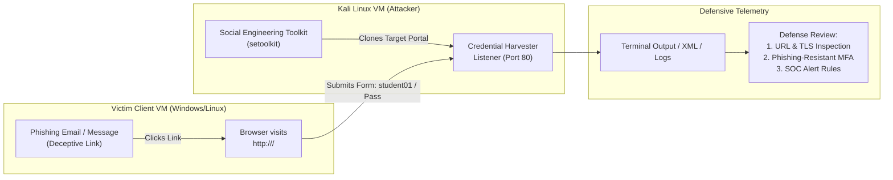

# Lab 5: Social Engineering Simulation and Phishing Detection

## 1. Overview & Context

- **Course Code**: CNS4001 — Computer Security
- **Module**: Social Engineering & Phishing Simulation
- **Estimated Duration**: 90–120 Minutes
- **Primary Tool**: Social Engineering Toolkit (`setoolkit` / SET) on Kali Linux
- **Environment**: Isolated Virtual Network (Host-Only / Internal Network)

Social engineering exploits human trust, urgency, curiosity, or deference to authority rather than technical software bugs. This lab provides an authorized, controlled simulation demonstrating how attackers clone legitimate login portals to harvest credentials via deceptive links, followed by an in-depth defensive analysis of email verification, network telemetry, and phishing-resistant authentication (FIDO2 / WebAuthn).

---

## 2. Authorization, Ethical Boundaries & Scope

> [!CAUTION]
> **Strict Operational Boundaries**:
> - Conduct this simulation **exclusively** within an isolated virtual lab environment.
> - **Zero External Impact**: Never target or clone public internet sites, university portals (e.g. UTech portals), or workplace systems.
> - **Dummy Data Only**: Use strictly fictional test accounts (e.g., `student01@example.test` and `LabOnly-Example-482!`). Never enter real passwords.
> - **No Real Email Transmission**: Never send phishing emails across public mail services (Gmail, Outlook, Yahoo) or to real recipients.
> - **Preserve Logs**: Maintain audit logs. Never attempt to conceal simulation activities.

---

## 3. What We Need to Get Started

### Virtual Machines & Network Setup

1. **Attacker Machine**: Kali Linux VM with Social Engineering Toolkit (`setoolkit`).
2. **Victim / Client Machine**: Windows 10/11 or Ubuntu Linux VM with a modern web browser.
3. **Hypervisor**: VirtualBox or VMware Workstation.
4. **Virtual Network**: Isolated **Host-Only Adapter** (e.g., `vboxnet0` / `192.168.56.0/24`) or **Internal Network** with DHCP enabled.

### Software & Packages

| System | Tool / Package | Installation / Setup Command | Purpose |
| :--- | :--- | :--- | :--- |
| **Kali Linux** | `setoolkit` | `sudo apt update && sudo apt install -y set` | Social Engineering Toolkit engine |
| **Kali Linux** | `apache2` / `python3` | Pre-installed | Web server infrastructure |
| **Client VM** | Browser (Firefox / Chrome / Edge) | Built-in | Client-side victim interaction |

---

## 4. Architecture & Workflow



---

## 5. Step-by-Step Completion Guide

### Phase 1: Environment Setup & Pre-Flight Check

1. **Take Clean Snapshots**: Before launching services, take a clean snapshot of both the Kali VM and Client VM.
2. **Determine IP Addresses**:
   - Kali VM:
     ```bash
     ip -br addr show
     ```
     *(Example: `192.168.56.101`)*
   - Client VM:
     ```powershell
     # On Windows:
     ipconfig
     # On Linux:
     ip -br addr show
     ```
     *(Example: `192.168.56.102`)*
3. **Verify Host-Only Interconnectivity**:
   - From Client VM, run: `ping <KALI_IP>`.
   - Confirm packets are delivered without network timeouts.

---

### Phase 2: Launch Credential Harvester in SET

1. On Kali Linux, launch the Social Engineering Toolkit:
   ```bash
   sudo setoolkit
   ```
2. Agree to the terms of service if prompted (`y`).
3. Follow the menu selection hierarchy:
   - Select option `1`: **Social-Engineering Attacks**
   - Select option `2`: **Website Attack Vectors**
   - Select option `3`: **Credential Harvester Attack Method**
   - Select option `2`: **Site Cloner** *(or option `1`: Web Templates for built-in mock templates like Google/Twitter)*
4. **Enter Configuration Parameters**:
   - **IP address for the POST back in Harvester/Tabnabbing**:
     Enter your **Kali VM IP address** (e.g. `192.168.56.101`).
   - **Enter the URL to clone**:
     Enter the instructor-provided local mock training site URL (e.g. `http://192.168.56.1/training-portal` or `http://example.test`).
5. SET starts a listener on port 80:
   ```text
   [*] The Social-Engineer Toolkit Credential Harvester Attack
   [*] Plugin: Credential Harvester (Web Attack)
   [*] Credential Harvester is running on port 80
   [*] Information will be displayed to you as it arrives below:
   ```

---

### Phase 3: Simulated Phishing Examination

Inspect the provided phishing notification template:

```text
Subject: Training Portal Account Review
From: Training Support <support@training-portal-auth.local>
To: student01@example.test

Hello Test User,

Please review your fictional training account immediately using the link below:
http://192.168.56.101/

Thank you,
Training Support Team
```

#### Key Observation Tasks:
1. **Source / Sender Analysis**: Note the sender display name vs actual domain.
2. **Urgency Indicators**: Identify psychological pressure (e.g. "Review immediately").
3. **Link Inspection**: Hover or inspect the hyperlink destination. It directs to a raw IP address (`http://192.168.56.101/`) lacking TLS/HTTPS encryption rather than an authentic institutional domain name.

---

### Phase 4: Controlled Credential Submission

1. On the **Client VM**, open a browser and navigate to the simulated page:
   ```text
   http://<KALI_IP>/
   ```
2. Confirm the page renders visually identical to the cloned template.
3. In the login form fields, submit the designated disposable credentials:
   - **Username**: `student01@example.test`
   - **Password**: `LabOnly-Example-482!`
4. Click **Submit / Log In**.
5. Switch to the **Kali Linux** terminal running SET:
   - The credential harvester intercepts the HTTP POST request and displays the submitted credentials in plaintext:
     ```text
     [*] WE GOT A HIT! Printing the key:value pairs:
     POSSIBLE USERNAME FIELD FOUND: student01@example.test
     POSSIBLE PASSWORD FIELD FOUND: LabOnly-Example-482!
     ```

---

### Phase 5: Cleanup & Evidence Preservation

1. Stop the SET listener on Kali by pressing `Ctrl + C`.
2. Save terminal output and logs from `/root/.set/` or copy the captured evidence.
3. Close the browser sessions on the client.
4. Verify that **only** dummy credentials were captured.
5. Revert VMs to clean snapshots if necessary.

---

## 6. Evaluation Questions & Answers Reference

### Question 1: Which message and webpage features could alert a recipient?
- **Answer**:
  1. **Sender Address Mismatch**: Display name says "Training Support", but the actual domain or email header originates from an unverified or mismatched sender.
  2. **Generic Salutation & Urgency**: Use of "Hello Test User" rather than personalized identifiers, combined with artificial urgency ("review immediately").
  3. **Raw IP / Insecure Protocol**: Link points to an unencrypted HTTP raw IP address (`http://192.168.56.101/`) rather than an authentic domain served over HTTPS with a valid certificate.
  4. **Missing Browser Padlock / Invalid Certificate**: Modern browsers display "Not Secure" warnings when submitting forms over plain HTTP.

### Question 2: Which observable events could help an analyst detect the activity?
- **Answer**:
  1. **DNS Query Logs**: Client resolving anomalous, newly registered domains (NRDs) or suspicious subdomains.
  2. **Web Proxy / Firewall Egress Logs**: Outbound HTTP traffic from multiple internal hosts to an unclassified external IP address.
  3. **Email Gateway Telemetry**: SPF/DKIM/DMARC alignment failures, high spam/phishing score flags, or presence of non-reputable links.
  4. **Host-Level Process Logs**: Web browsers spawning child execution processes or invoking external credential dialogues.

### Question 3: Why should users avoid entering credentials after following an unexpected message link?
- **Answer**: Hyperlinks in unsolicited messages can lead to attacker-controlled lookalike infrastructure. Attackers easily replicate visual aesthetics (logos, CSS, fonts). Manually navigating to a verified bookmark or typing the known authentic domain directly eliminates the risk of clicking malicious redirects.

### Question 4: How could email filtering, reporting tools, password managers, and authentication controls reduce risk?
- **Answer**:
  - **Email Filtering (Secure Email Gateways - SEG)**: Strips or quarantines phishing messages using heuristic analysis and reputation feeds.
  - **Reporting Tools (Report Phish Add-in)**: Allows users to flag suspicious emails directly to the SOC with one click.
  - **Password Managers**: Use strict domain-matching autofill. A password manager will **refuse** to autofill credentials on `http://192.168.56.101/` when the legitimate site is `https://portal.university.edu`.
  - **Authentication Controls**: Enforce MFA policies requiring secondary verification factors.

### Question 5: What is the difference between ordinary MFA and phishing-resistant authentication?
- **Answer**:
  - **Ordinary MFA (SMS, TOTP Authenticator apps, Push Notifications)**: The attacker’s proxy or harvester page can prompt the user for the 6-digit TOTP code or trigger a push notification, allowing the attacker to replay it against the real service in real time (AiTM / Evilginx attack).
  - **Phishing-Resistant MFA (FIDO2 / WebAuthn / Passkeys / Smart Cards)**: Cryptographically binds the authentication assertion to the exact TLS origin and domain name (`origin.domain`). If the user submits on `192.168.56.101`, the cryptographic signature is invalid on the authentic domain, completely thwarting credential harvesting.

### Question 6: Why does collecting a password not necessarily mean that an attacker can access an account?
- **Answer**:
  1. **Active Multi-Factor Authentication (MFA)**: Access requires possession of a secondary hardware key or authenticator.
  2. **Conditional Access Policies**: Enterprise identity providers (IdPs) restrict access based on device compliance (Intune/MDM), trusted IP ranges, or behavioral impossible travel alerts.
  3. **Account Lockout / Rate Limiting**: Abnormal authentication spikes trigger automated account suspension before the adversary can execute logon.

### Question 7: What authorization, privacy, evidence-handling, and debriefing requirements should apply to a professional simulation?
- **Answer**:
  1. **Written Rules of Engagement (RoE)**: Formal executive sign-off defining in-scope systems, testing schedules, and emergency contacts.
  2. **Data Privacy Protection**: Captured credentials must be masked or salted/hashed immediately; actual employee passwords must never be stored in cleartext.
  3. **No Disruption Guarantee**: Critical infrastructure, customer portals, and emergency communications must be excluded.
  4. **Educational Debriefing**: Immediate constructive training for users who submitted data, focusing on education without punitive measures.

### Question 8: What does this simplified exercise fail to represent about real phishing incidents?
- **Answer**:
  1. **Adversary-in-the-Middle (AiTM) Proxies**: Real modern phishing uses reverse proxies (such as Evilginx3 or Modlishka) that proxy live traffic to the real service, harvesting active session cookies/tokens and bypassing standard 2FA.
  2. **Spear-Phishing & OSINT Personalization**: Attackers research specific employee projects, vendors, and colleagues to construct convincing pretexts.
  3. **Multi-Channel Attacks**: Combining SMS (smishing), phone calls (vishing), and fake QR codes (quishing).

---

## 7. Optional Extension: Defender Investigation

### 1. Timeline of Events
| Timestamp | Event Source | Activity Observed | Interpretation |
| :--- | :--- | :--- | :--- |
| `10:00:15` | Mail Log | Email received from `<support@training-portal-auth.local>` | Phishing delivery |
| `10:02:40` | Web Proxy | Client `192.168.56.102` HTTP `GET /` to `192.168.56.101` | Initial site visit |
| `10:03:12` | Web Proxy / SET | Client `192.168.56.102` HTTP `POST /login` | Form credential submission |
| `10:03:15` | Web Proxy | HTTP 302 Redirect to authentic landing page | Attacker redirect evasion |

### 2. Distinguishing Visit vs Submission
- **Visit**: Indicated by an HTTP `GET` request for HTML documents, stylesheets, and images.
- **Submission**: Indicated by an HTTP `POST` method containing form payloads (`application/x-www-form-urlencoded` or `multipart/form-data`) carrying credential parameter fields.

### 3. Proposed Detection Rule (Sigma / Splunk)
```yaml
title: Potential Credential Harvester POST to Raw IP
status: experimental
description: Detects outbound HTTP POST requests directly to private or unclassified IP addresses rather than validated domain names.
logsource:
  category: proxy
detection:
  selection:
    cs-method: 'POST'
    c-uri-stem|contains:
      - 'login'
      - 'auth'
      - 'signin'
    r-dns: ''  # Direct IP destination without domain name
  condition: selection
level: high
```
- **False Positive Consideration**: Legacy internal intranet management appliances that rely on raw IP addressing. Exclude approved internal CIDR ranges.

---

## 8. Required Deliverables Checklist

- [ ] **Network Architecture Diagram**: Visual layout showing Kali attacker VM and Client victim VM on host-only subnet.
- [ ] **Screenshots**:
  1. Client browser displaying the simulated login page and the raw IP URL bar.
  2. Kali terminal showing `setoolkit` intercepting the dummy credentials (`student01@example.test` / `LabOnly-Example-482!`).
- [ ] **Lab Report Answers**: Completed responses to all 8 evaluation questions in Section 6.
- [ ] **Scope & Boundaries Confirmation**: Explicit confirmation that testing was restricted strictly to the virtual lab environment using dummy accounts.
