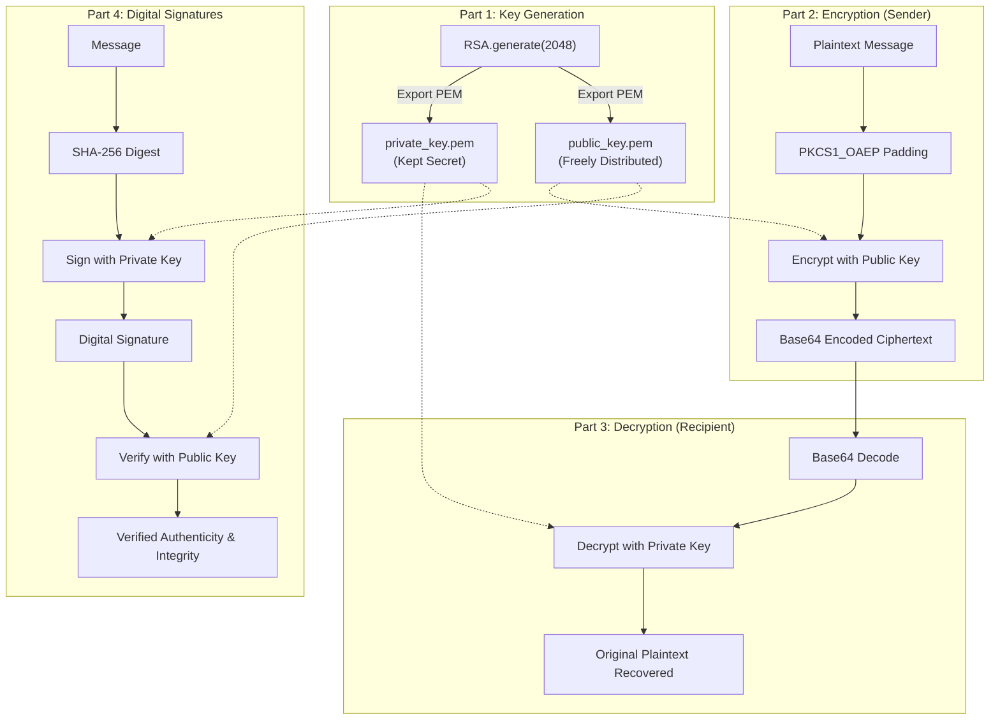

# Lab 6: Asymmetric Encryption using RSA (Rivest–Shamir–Adleman)

## 1. Overview & Context

- **Theme**: Public-Key Cryptography, Confidentiality, and Digital Signatures
- **Algorithm**: RSA (Rivest–Shamir–Adleman) with 2048-bit modulus
- **Padding Scheme**: Optimal Asymmetric Encryption Padding (`PKCS1_OAEP`) & `PKCS#1 v1.5` for signatures
- **Language / Environment**: Python 3 running via repository virtual environment (`.venv`)
- **Key Library**: `pycryptodome`

Public-key (asymmetric) cryptography solves the fundamental key distribution problem inherent in symmetric cryptography. By generating a mathematically linked key pair—a **Public Key** for encryption / signature verification and a **Private Key** for decryption / signature signing—parties can establish confidential and authenticated communications without ever sharing secret keys across untrusted channels.

---

## 2. What We Need to Get Started

### System & Environment

- **Host OS**: Windows 10/11 or Linux
- **Python**: Repository virtual environment located at `.venv`:
  - Windows: `.\.venv\Scripts\python.exe`
  - Linux: `./.venv/bin/python`
- **Dependencies**: `pycryptodome` installed in `.venv`.

### Installation & Verification

Verify the library inside `.venv`:
```powershell
.\.venv\Scripts\python.exe -c "from Crypto.PublicKey import RSA; print('PyCryptodome loaded successfully!')"
```

---

## 3. Learning Objectives

By the end of this lab, you will be able to:

1. **Understand Asymmetric Cryptography**: Explain mathematical trapdoor one-way functions and key-pair relationships.
2. **Generate Cryptographic Key Pairs**: Export and store 2048-bit RSA keys encoded in Privacy-Enhanced Mail (`PEM`) format.
3. **Implement OAEP Padding**: Explain why raw ("textbook") RSA is vulnerable to deterministic attacks and how Optimal Asymmetric Encryption Padding (`PKCS1_OAEP`) injects randomness.
4. **Execute Asymmetric Encryption & Decryption**: Encrypt plaintext using a public key and recover the original plaintext using the matching private key.
5. **Implement Digital Signatures**: Compute SHA-256 message digests and generate/verify digital signatures (`pkcs1_15`) to achieve integrity and non-repudiation.

---

## 4. Architecture & Workflow



---

## 5. Step-by-Step Completion Guide

All code is integrated into a single standalone, production-ready script: [`rsa_lab.py`](rsa_lab.py).

### Part 1: Key Generation

We generate a 2048-bit RSA key pair and write both keys to disk in standard PEM encoding:

```python
from Crypto.PublicKey import RSA

# 1. Generate 2048-bit RSA key pair
key = RSA.generate(2048)

# 2. Export and save the private key
private_key = key.export_key()
with open("private_key.pem", "wb") as f:
    f.write(private_key)

# 3. Export and save the public key
public_key = key.publickey().export_key()
with open("public_key.pem", "wb") as f:
    f.write(public_key)

print("RSA key pair generated and saved to private_key.pem and public_key.pem")
```

### Part 2: RSA Encryption

The sender reads the recipient's public key, pads the message using `PKCS1_OAEP` (which mitigates chosen-ciphertext attacks), and encrypts it:

```python
import base64
from Crypto.Cipher import PKCS1_OAEP
from Crypto.PublicKey import RSA

# Load public key
with open("public_key.pem", "rb") as f:
    recipient_key = RSA.import_key(f.read())

message = "Hello, welcome to the world of RSA encryption!"
cipher_rsa = PKCS1_OAEP.new(recipient_key)
ciphertext = cipher_rsa.encrypt(message.encode("utf-8"))

# Base64 encode for transport / printing
encoded_encrypted_message = base64.b64encode(ciphertext).decode("utf-8")
print("Encrypted Message (Base64):", encoded_encrypted_message)
```

### Part 3: RSA Decryption

The recipient reads their private key, decodes the ciphertext from Base64, and decrypts the ciphertext:

```python
import base64
from Crypto.Cipher import PKCS1_OAEP
from Crypto.PublicKey import RSA

# Load private key
with open("private_key.pem", "rb") as f:
    private_key = RSA.import_key(f.read())

decoded_ciphertext = base64.b64decode(encoded_encrypted_message)
cipher_rsa = PKCS1_OAEP.new(private_key)
decrypted_message = cipher_rsa.decrypt(decoded_ciphertext).decode("utf-8")

print("Decrypted Message:", decrypted_message)
```

### Part 4: Digital Signature Challenge (Integrity & Authenticity)

A digital signature proves that the message originated from the private key owner and was not tampered with in transit:

```python
from Crypto.Hash import SHA256
from Crypto.PublicKey import RSA
from Crypto.Signature import pkcs1_15

# Load keys
with open("private_key.pem", "rb") as f:
    signing_key = RSA.import_key(f.read())
with open("public_key.pem", "rb") as f:
    verifying_key = RSA.import_key(f.read())

message = b"This is a very important message."

# 1. Hash the message
hash_obj = SHA256.new(message)

# 2. Sign the hash using private key
signature = pkcs1_15.new(signing_key).sign(hash_obj)
print("Digital Signature generated successfully.")

# 3. Verify using public key
try:
    pkcs1_15.new(verifying_key).verify(hash_obj, signature)
    print("The signature is valid! (Integrity & Authenticity confirmed)")
except (ValueError, TypeError):
    print("The signature is not valid! (Tampering detected)")
```

---

## 6. Discussion Questions & Answers Reference

### Question 1: What are the advantages and disadvantages of RSA compared to symmetric encryption (e.g., AES)?
- **Advantages of RSA**:
  1. **Key Distribution**: No pre-shared secret key is required. Public keys can be broadcast openly without compromising security.
  2. **Digital Signatures & Non-Repudiation**: RSA provides asymmetric signing, allowing any recipient to verify origin authenticity.
  3. **Scalability**: In an $N$-person network, RSA requires only $2N$ keys (one public/private pair per entity), whereas symmetric encryption requires $\frac{N(N-1)}{2}$ shared keys.
- **Disadvantages of RSA**:
  1. **Computational Speed**: RSA involves heavy modular exponentiation with very large integers, making it hundreds to thousands of times slower than hardware-accelerated AES.
  2. **Data Size Limitations**: RSA can only encrypt data smaller than its modulus size minus padding overhead (e.g. 2048-bit RSA with OAEP can encrypt at most 190 bytes).
  3. **Hybrid Solution**: In production protocols (such as TLS/HTTPS), RSA is used only to securely exchange a symmetric AES session key, which then encrypts the bulk payload.

### Question 2: What happens if the private key is compromised?
- **Answer**:
  1. **Complete Loss of Confidentiality**: Any adversary holding the private key can decrypt all past, intercepted, and future ciphertexts encrypted with the corresponding public key.
  2. **Total Identity Impersonation**: The adversary can generate valid digital signatures for arbitrary files, software, or messages, completely undermining trust.
  3. **Remediation Required**:
     - The compromised key pair must be revoked immediately (via Certificate Revocation Lists - CRL or OCSP).
     - A new key pair must be generated.
     - Affected users and certificates must be re-keyed and audited.

### Question 3: How could you prove non-repudiation?
- **Answer**:
  - **Non-repudiation** guarantees that the sender of a message cannot falsely deny having sent the message.
  - **Proof Mechanism**:
    1. A cryptographic hash of the message is signed using the sender's **Private Key**.
    2. Because the private key is strictly unique to the sender and never disclosed, only that specific sender could mathematically produce a valid signature verifiable by their Public Key.
    3. When paired with a **Public Key Infrastructure (PKI)** digital certificate and an authorized **Cryptographic Timestamp Authority (TSA)**, the signature proves both the sender's identity and that the signing occurred before any key revocation, providing binding legal evidence.

---

## 7. Execution Instructions

Run the complete lab script using the repository's `.venv`:

```powershell
.\.venv\Scripts\python.exe Labs\Lab6\rsa_lab.py
```

### Expected Output

```text
============================================================
              LAB 6: RSA CRYPTOGRAPHY RUNTHROUGH            
============================================================

[+] STEP 1: Generating 2048-bit RSA Key Pair...
    - Saved private key -> private_key.pem
    - Saved public key  -> public_key.pem

[+] STEP 2: Encrypting Plaintext Message with Public Key (PKCS1_OAEP)...
    - Original message: 'Hello, welcome to the world of RSA encryption!'
    - Ciphertext (Base64): W3k8...[truncated]...==

[+] STEP 3: Decrypting Ciphertext with Private Key...
    - Decrypted text: 'Hello, welcome to the world of RSA encryption!'
    - Verification: SUCCESS - Decrypted text matches original plaintext!

[+] STEP 4: Digital Signature & Verification Challenge...
    - Message to sign: 'This is a very important message.'
    - Generated SHA-256 digest and signed with Private Key.
    - Verified signature with Public Key: The signature is valid!
    - Tamper test with modified message: Correctly caught invalid signature!

[SUCCESS] Lab 6 RSA demonstration finished cleanly.
```

---

## 8. Required Deliverables Checklist

- [ ] **Generated Key Files**: `private_key.pem` and `public_key.pem` in `Labs/Lab6/`.
- [ ] **Executable Code**: Complete `rsa_lab.py` script.
- [ ] **Terminal Output / Screenshot**: Output showing key generation, Base64 ciphertext, successful plaintext recovery, and digital signature verification.
- [ ] **Discussion Answers**: Answers to the 3 questions in Section 6.
